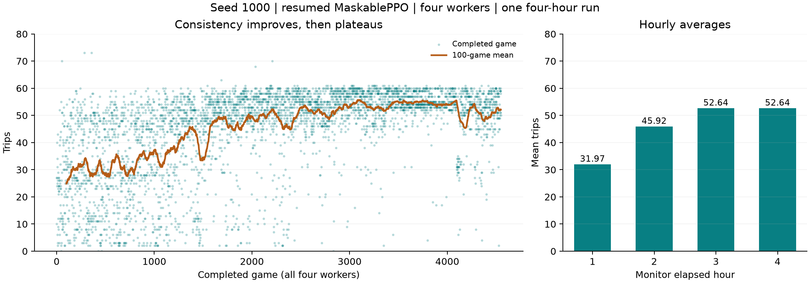

# Training documentation and evidence


Durable record through 28 October 2026. These documents, reports, figures and

selected measurements are tracked in Git. Neural-network weights, generated

players and scratch captures remain local and are not backed up by this archive.


| Record | Purpose |

| --- | --- |
| [Seed2000 regression diagnosis](regression-2000-2026-10-31/README.md) | 235 vs83 reproduced; upgrade first divergence, later route/wait differences, causal test proposed |
| [Regression diagnostic preparation](regression-diagnostic-preparation-2026-10-31/README.md) | User-run frozen seed2000 comparison, decision alternatives and traffic traces; smoke only |

| [Two-hour continuation](signal-context-continuation-2026-10-30/README.md) | Development228.0->186.4; starting checkpoint protected; pause and diagnose |

| [V4 light-availability result](signal-context-light-results-2026-10-30/README.md) | ON177.5 vs OFF159.1; 3 wins/6 ties/1 loss, frozen policy and mixed effects |

| [V4 fresh-map result](signal-context-fresh-2026-10-30/README.md) | Deterministic175.9->194.0 driven by two maps; sampled essentially tied, 40 frozen games and limits |

| [Completed v4 trial summary](signal-context-run-2026-10-29/summary.json) | One hour: validation204.2->228.0, mostly one map; fresh-map test prepared for user, not run yet |

| [Queue-cause v4 contract and command](../../training/SIGNAL_CONTEXT.md) | Added current queue/destination inputs, weight-preserving warm start, short checks; no long performance test yet |

| [Seed5009 light failure diagnosis](light-failure-5009-2026-10-29/README.md) | First divergence, fixed-command first/second-light counterfactuals, parking-queue observation gap, replays and limits |

| [Light availability results](light-availability-2026-10-29/README.md) | ON190.9 vs OFF209.9 on ten paired maps; aggregate decline dominated by seed5009, not universal harm |

| [Traffic-light ON/OFF command](../../training/TRAFFIC_LIGHT_TEST.md) | Prepared paired frozen-policy availability test; full run pending; short smoke measurements in light-test-preparation-2026-10-29 |

| [Fresh-map evaluation](signals-fresh-2026-10-29/README.md) | Frozen ten-map comparison: deterministic161.3->207.4, sampled182.0->188.9; 40 games, unchanged weights, limits and replays |

| [Partial overnight result](signals-overnight-2026-10-29/README.md) | Early stop at4h18m, saved best494, development mean167.4->204.2; cause unknown and fresh-map test pending |

| [Traffic-light v3 audit and pilots](signals-2026-10-29/README.md) | Old-policy decision audit, paired prior-temperature pilots, stock/replay/update checks and overnight preparation; no proven score gain |

| [Congestion v2 comparison](congestion-v2-2026-10-28/README.md) | Live-map/bypass inputs, frozen three-map ablation, mixed results and startup checks; no long training |

| [Latest investigation PDF](model-investigation-2026-10-28.pdf) | Ten-page report: ten experiments, 356-trip planner-aided record, independent tests and limited learning evidence |

| [Investigation evidence](investigation-2026-10-28/README.md) | 312 archived source/metric/log/replay files, frozen selection, report figures/text and integrity manifests |

| [Experiment history](../../training/EXPERIMENT_HISTORY.md) | Chronological decisions, engineering choices, reasons, changes, failures, analysis, results and unresolved hypotheses |

| [Three-hour investigation](../../training/EXPERIMENT_2026_10_28.md) | Authorized controlled pilots, optional priors/masks, credit-window comparison and distinct heuristic baseline |

| [Earlier simulator decisions](../../simulation/Docs/DESIGN_DECISIONS.md) | Original/Custom design history before training |

| [Current training status](../../training/CURRENT_STATUS.md) | Latest implemented behavior and results |

| [Connectivity reward update](../../training/REWARD_SHAPING.md) | Shaping design, anti-loop accounting, tests; later results are in the investigation |

| [Connection reward audit](connectivity-reward-audit-2026-10-28.json) | Scripted baseline/shaped comparison; unchanged 73-trip game and early feedback |

| [Multi-seed live check](live-check-multi-seed-shaped-01-2026-10-28.json) | Read-only first-556-game snapshot; active optimizer, no demonstrated score improvement |

| [Stopped-run assessment](stopped-run-assessment-2026-10-28.json) | Final multi-seed summary and frozen initial/final comparison on five held-out seeds |

| [Earlier model report](current-model-report-2026-10-28.pdf) | Preserved 12-page pre-investigation snapshot of the four-hour experiment |

| [Earlier report text](CURRENT_REPORT_TEXT.md) | Full searchable text from that historical PDF |

| [Exact model contract](../../training/README.md) | Actions, input channels, reward, timing and evaluation |

| [Commands and controls](../../training/QUICKSTART.md) | Start, stop, resume, parallel workers and replay |

| [Original model report](first-model-report.pdf) | Unchanged 16-page PDF, including every graphic |

| [Searchable PDF text](FIRST_REPORT_TEXT.md) | Full page-by-page extraction; PDF remains authoritative for layout |

| [First-run analysis](../../training/first-run.md) | Baseline measurements and interpretation |

| [Traffic/scale investigation](../../simulation/Reports/traffic-and-scale-investigation.md) | Road, crossing and roundabout evidence |

| [Run evidence manifest](evidence-2026-10-28/manifest.json) | Paths, sizes and SHA-256 for 56 archived run/benchmark files |

| [Report manifest](REPORT_MANIFEST.json) | Hashes for the archived PDF, figures, replay and rebuild source |

| [Archive validation](VALIDATION.md) | Integrity, coverage, visual checks and remaining evidence limitations |


## Complete PDF coverage


The PDF is historical: its statements about zero held-out scores and no longer

run having started describe the first experiment, not the later four-hour run.

Newer findings are recorded separately without rewriting the original report.

The 12-page report also predates the connectivity-reward update. The shaping

specification describes that newer code. Later shaped and planner-aided results

are preserved in the latest investigation, without rewriting those older PDFs.


| Page | Content preserved | Figure or evidence |

| --- | --- | --- |

| 1 | Scope, goal and baseline conclusion | Original PDF |

| 2 | Hardware, budget, distribution, speed and memory | [Speed graph](first-report-figures/speed.png), config/progress |

| 3 | Observations, withheld information and aggregation limits | Full report text and model contract |

| 4 | All tools, masks, command stages and timing | Full report text and recorded source revision |

| 5 | Actor/critic architecture and 450,610 parameters | [Parameter plot](first-report-figures/parameters.png) |

| 6 | Trip reward, delayed credit, rollouts and on-policy learning | Full report text |

| 7 | PPO objective, GAE, settings, update counts and selection-level discounting | Full report text and config |

| 8 | Scores, rolling mean and no sustained improvement | [Scores](first-report-figures/scores.png), all 242 episodes |

| 9 | Survival, sparse reward, four positive games/seeds | [Survival](first-report-figures/survival.png) |

| 10 | Entropy, KL, clip fraction, value loss and limits | [Optimizer graphs](first-report-figures/diagnostics.png), progress CSV |

| 11 | Deterministic behavior and exhausted materials | [Maps](first-report-figures/maps.png), [materials/actions](first-report-figures/inventory.png), archived inference snapshots |

| 12 | Held-out comparison and three-seed limitation | [Evaluation](first-report-figures/evaluation.png), summary |

| 13 | Interpretation and proposed unperformed experiments | Full report text and history T03/T11 |

| 14 | Reproduction, packages, source revision and validation | Config and first-run guide |

| 15 | All input indices and clipping/entity-detail limitations | Full report text and model contract |

| 16 | Glossary, evidence and algorithm reference distinctions | Original PDF and full report text |


## Four-hour performance





Source: archived `seed-1000-parallel-02/worker-*.monitor.csv`, merged by completion

time. Each dot is a completed game; the rolling mean covers 100 games, not 100

seconds. Hour bins omit completions outside monitor seconds 0-14,400; setup

precedes the learner timer. This is one resumed single-seed run, not an

independent algorithm comparison or evidence of generalization.


## Evidence and reproduction


The retiring-pavement correction also preserves matching

[before](retiring-pavement-before.png) and [after](retiring-pavement-after.png)

viewer captures at simulated second 44 of the earlier best replay. These are

display evidence, not different model results.


`evidence-2026-10-28/runs/` contains available configs, summaries, final status,

seed summaries, episode JSONL, optimizer CSV, monitor CSV and best command

recordings for all seven run folders. The crashed run has no final summary;

none was fabricated. Benchmark trials are archived separately. Source revisions

are in Git; checkpoints and source snapshots remain in local run folders.

Hashes establish copy integrity, not simulator fidelity.


Verify without training or writing files:


```powershell

.venv/Scripts/python.exe training/archive_documentation.py --destination docs/training/evidence-2026-10-28 --verify

```


For future snapshots use a new destination; existing archives are never overwritten:


```powershell

.venv/Scripts/python.exe training/archive_documentation.py --destination docs/training/evidence-NEXT-SNAPSHOT

```


[plot_results.py](plot_results.py) regenerates the four-hour graph from archived

CSV, using Matplotlib. [rebuild_first_report.py](rebuild_first_report.py) reads

the archived baseline/replay and writes scratch graphs under

`tmp/pdfs/archived-model-report/` and a historical rebuild under

`output/pdf/first-model-report-rebuilt.pdf`. It requires NumPy, Matplotlib,

Pillow, ReportLab and Windows Arial fonts. Only paths were adapted from the

original script; the historical prose is unchanged. The archived first-report

replay contains inference snapshots, not the native best-game replay schema.

Neither script trains or loads a policy. Rebuilt PDFs may differ in binary

metadata and require fresh visual review before distribution; the original

archived PDF is byte-for-byte preserved.


[build_current_report.py](build_current_report.py) rebuilds the current 12-page

report from the archived run/benchmark data and existing learning-curve figures.

It writes `output/pdf/mini_motorways_current_model_report.pdf` and the tracked

dated PDF, plus the current held-out and speed figures. It needs the same PDF

and plotting libraries/Windows fonts as the historical builder. Current report

figures and text are included in the supplementary hash manifest.


## Continuing record


Every later material update/experiment must record request, decision, rationale,

implementation, evidence, outcome and limits. Results need their protocol,

run/config identity, metric definition and sample size. Preserve superseded

decisions and distinguish proposals from performed work. Update current guides

and preserve graph/data sources before deleting ignored artifacts. Mark missing

evidence unknown instead of reconstructing unsupported facts.

