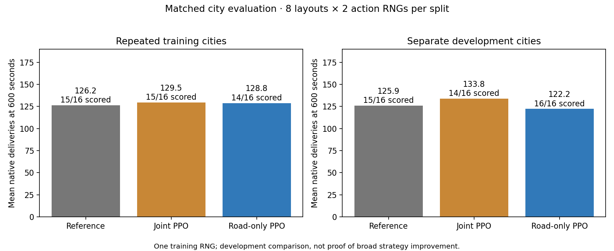

# Road-choice-only PPO diagnostic — completed 24 November 2026

## Decision and scope

Do not promote this candidate, restore joint learning from it, or start a long run. Freezing learned Wait corrections did not establish better city scores. Retain the reference and all experimental checkpoints. This is a measured negative result for this configuration and budget, not proof that PPO cannot learn road strategy.

User authorized the proposed diagnostic with “Go ahead”. Work stayed in `/home/mohammadjaffal/mini_motorways`, branch `Maskable-PPO`, HEAD `6bd7f7193b26ae0f5aa12563f3dd89769115df6e` plus preserved dirty work. The Desktop checkout was not changed. No planner, imitation, reward penalty, native simulator change, pull, reset or commit was used.

## Implementation and controlled comparison

Added `training/city_road_choice_policy.py`. It inherits the whole-city policy and freezes both learned Wait correction modules. Relational road heads, spatial road head, shared spatial encoder and value head remain trainable. Their existing relative learning rates are .3/.1/.1. The optimizer has three groups, with a trainable road parameter first so the trainer's Adam counter remains valid.

Preparation starts from the same zero-output whole-city initialization used for the prior joint run, not from its trained candidate. Both Wait output layers must be zero: a nonzero frozen visual head could change its output when its shared encoder learns. All inherited weights and value predictions initially match exactly. The initialization already has zero Adam steps, so no learned optimizer history was discarded; historical timestep/update counters were copied. Existing candidates remain preserved.

Four rollouts × 16 workers × 512 steps = **32,768 added decisions**, **1,024 actual Adam updates**, **64 completed episodes**, **450.47 seconds of training**. Of the episodes, 36 reached the 600-second training truncation and 28 ended natively. The continuing-task bootstrap remains enabled; this is not the prior finite-horizon variant. PPO settings: LR .0001, gamma/GAE 1, batch 128, four epochs, value coefficient .00001, native delivery reward, bridges and forced-Wait collapsing. Eight repeated native layouts: 184000000–184000007. First eight completed pre-update games match the joint run's native metrics exactly, excluding wall time and two subsequently added reporting flags.

The initial launch selected system Python by resolving the virtualenv symlink and failed on missing torch before training. Its files remain in `city-road-choice-fit-01`. Corrected launch used the virtualenv path without resolving it and completed in `city-road-choice-fit-02`. A separate disposable preflight gradient probe initially replaced SB3's mutable distribution with a no-grad distribution; ordering that probe correctly fixed the check. Neither issue changed saved model weights or lost training progress.

## Matched scores

Each split contains eight layouts × two action RNGs = 16 games, evaluated for up to 600 native seconds. Separate layouts 185000000–185000007 have already been used for development selection; they are not independent confirmation data. Reference/joint results are cached from the previous experiment and use the same host, layouts and sampling RNGs.

| Policy | Repeated mean | Repeated scoring | Separate mean | Separate scoring |
|---|---:|---:|---:|---:|
| Reference | 126.25 | 15/16 | 125.94 | 15/16 |
| Prior joint PPO, 32k | 129.50 | 15/16 | 133.75 | 14/16 |
| Road-only PPO, 32k | 128.81 | 14/16 | 122.25 | 16/16 |

Road-only minus reference: repeated **+2.56**, paired city-cluster 95% bootstrap interval **[−11.06, +18.31]**; separate **−3.69**, interval **[−51.50, +46.44]**. Road-only minus joint: repeated −0.69 [−22.31, +25.25]; separate −11.50 [−67.75, +53.75]. The bootstrap resamples eight cities, keeping their two action RNGs together, with 12,000 draws and fixed seed 142915. It does not measure variation across training RNGs: only one was trained.

The candidate scored in all 16 separate games but lost one scoring repeated game; the overall reliability evidence is mixed. Native target arrivals with no road stock: reference 24/20 repeated/separate, joint 32/31, road-only 22/21. Newly arriving targets served: reference 69/76, joint 71/78, road-only 71/77. These small differences do not demonstrate a conservation or service strategy improvement.

## What actually learned

All 1,024 optimizer steps completed. The first 64 gradient-audited updates had mean pre-clip norms approximately .02222 for road heads, .00001905 for the spatial encoder and .07257 for the critic. This confirms gradients reach the allowed groups, not that those gradients improve strategy.

The final checkpoint changed 58 state-dictionary tensors (including aliased feature-extractor entries); changes are restricted to allowed strategy/critic tensors, with **no Wait or inherited prior tensor changes**. All tensors remain finite. On 94 shared observations along two reference trajectories, maximum Wait probability difference was **7.75e−7** (floating-point normalization noise). Mean conditional-road total variation was **0.002140 (0.214%)**, versus **0.000702 (0.070%)** for joint training on the same states. More road movement is not necessarily better road choices.

Across 16 initial city states, road-only conditional-road total variation grew from .000222 at midpoint to .000839 at final (0.022% → 0.084%). The prior joint final's opening mean was .000370. Thus freezing Wait increased road preference movement in this comparison, but the movement remained small and score improvement did not follow. Total variation is probability mass redistribution, not accuracy or percent score improvement.

The 32-action-RNG opening probe on layout 184000000 at 180 seconds scored in **26/32** games versus **27/32** for reference and joint final. Mean scores were 13.56 / 13.25 / 13.31, respectively; delivery by 60 seconds occurred in 26 / 25 / 26 games. No improved opening reliability is established. These are known-layout sampling replicates, not 32 new cities.

## Watched games

Two anchors were selected before candidate evaluation; both replay traces exactly reproduce their evaluation records. Both frame sheets and the score plot were visually inspected. Interactive HTML uses the existing replay template; no browser rendering test is claimed.

- [Previously scoreless opening](watched-failed-opening/replay.html), seed 184000000 / action RNG 193251: reference **0**, joint **175**, road-only **0**. Road-only dies at 151.15 seconds with no stock; it still builds branches/loops before completing useful service. Its first differing action from reference is zero-based decision 51. [Frames](watched-failed-opening/frames.png).
- [Previously scoring opening](watched-scoring-opening/replay.html), seed 184000003 / action RNG 193254: reference **158**, joint **172**, road-only **147**. Road-only dies at 563.7 seconds with **18 road units left** and later destination 22 still unserved. Its first action difference from reference is decision 177. This is evidence that promptly connecting later demand remains a problem even when stock is available at the end; it does not identify the exact causal failure or prove that 18 units were available when that target arrived (arrival stock was zero). [Frames](watched-scoring-opening/frames.png).

The prior selected 0→175 joint replay was not evidence of reliably repaired road selection. This road-only result is consistent with that earlier warning, although it cannot decompose every downstream cause of the joint replay's improvement.

## Next hypothesis, not executed

A bounded road-head learning-rate comparison is the next useful test: increase only road-head update scale while preserving this frozen-Wait control, spatial/critic rates, native reward, PPO KL safeguard and matched evaluations. First ask whether substantially larger road-policy movement can improve repeated-city returns, then require retained separate-city scores and fresh confirmation. This is a hypothesis about weak effective policy change, not a proven learning-rate defect or promise that more aggressive updates will help. If larger road changes still fail to improve even repeated cities, investigate delayed credit and training distribution before spending a night on the same setup. No reward redesign, planner, imitation or long continuation has been authorized by this result alone.

## Evidence and local-only artifacts

`PLAN.md`, `initial-checks.json`, `preupdate-episode-check.json`, `trained-policy-audit.json`, opening audits/probes, `replay-comparison.json`, `replay-evaluation-check.json`, `results.json`, `evaluation/`, `measurements/`, source scripts and `runtime-source-02/` preserve the small evidence. `local-artifacts.json` lists local checkpoint/host hashes; `manifest.json` indexes the archive. Weights and native binaries are intentionally not copied into documentation.

Final checkpoint: `output/training/city-road-choice-fit-02/roads/final.zip`, SHA-256 `4adfead05746e25456933231b3e6fd46ed9f04141f8963e71da3d4177727bf58`. Initial checkpoint: `output/training/city-road-choice-initial-01/start.zip`, SHA-256 `81470b70541d0fb2030886c85b8209c4ec0333eb22bd5f30a63f2764f9197a9f`. The original parent hashes remain unchanged. Training, evaluation, replay and probe jobs have completed; no long training run was started.
