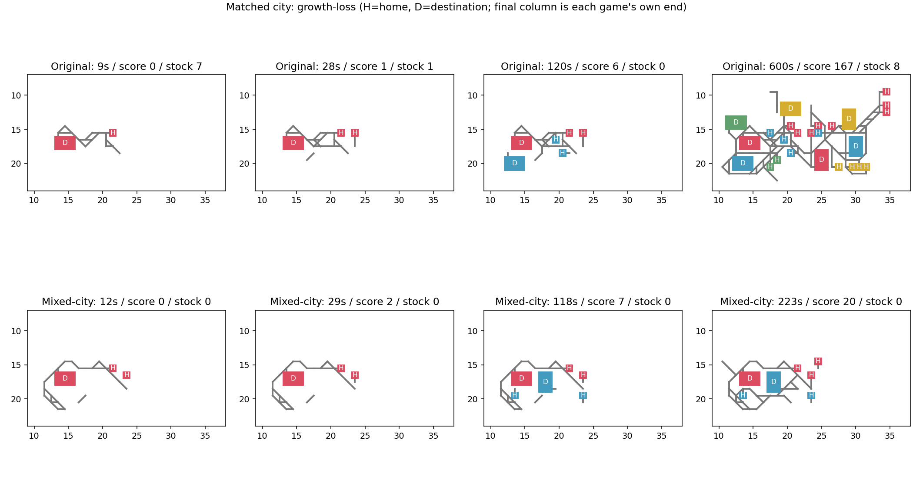

# City transfer diagnosis —25November2026

## User authorization and scope

After discussing a research-grounded diagnosis followed by targeted training and city transfer checks, the user said “Go ahead do sll.” Work stays in `/home/mohammadjaffal/mini_motorways`, branch Maskable-PPO, with existing dirty work preserved. No pull/reset/commit, handoff patch, planner or new imitation. Original and newer checkpoints are all retained. No simulator changes are made in this investigation.

## Measured whole-suite evidence

Reused the previously evaluated32city trajectories per model (16development cities, two action RNGs each). These are not new independent tests. Original:2zero-score games,145of162later destinations served,44arrivals with no road stock. Practice parent:5zeros,96of122served,108empty-stock arrivals. Lesson-only final:2zeros,121of151served,150empty-stock arrivals. Mixed-city final:2zeros,119of147served,125empty-stock arrivals.

Cities evolve differently under different actions, and earlier game-over reduces exposure to later arrivals. These conditional counts are descriptive, not identical workloads or isolated causal effects. Nonetheless, they point toward road availability and later service as diagnostic targets, beyond simply completing an opening route.

## Matched replay findings

Selected the largest mixed-minus-original loss, median difference and largest win before replay; then added the largest loss in which both models scored to examine a later-service failure. Each case was replayed with original, lesson-only and mixed-city policies:12games. Frozen native final scores, elapsed time, stock, actions, awards and paid units match their archived evaluation records. The action-sampling seed is shared; it does not force identical paths or isolate road ranking from changes in Wait probability.

- Opening failure example: original148deliveries, mixed0. Replay frames show both spending initial roads, but the mixed road network remains disconnected. A large mixed win in another city (171versus original0) demonstrates that one selected failure is not universal competence evidence.
- Later-service example, seed184000000/action193351: original first delivery21seconds/final167; lesson-only15seconds/final76; mixed17seconds/final20. Faster first service did not imply better city survival.
- In that later-service case, the first road award is exhausted after27seconds by the original, immediately by lesson-only, and after3seconds by mixed. In the median case, original award-to-next-empty delays are98/40/130seconds for the first three awards; lesson-only0/5/2; mixed21/14/19. This metric measures the first later empty stock and can span another award; it is not tracking the lifetime of individual units.
- On sampled observations along the later-service candidate trajectories, their mean Wait probability is roughly0.29lower than the original evaluated on those exact same observations. Conditional-road differences are also archived. This establishes a behavior difference, not that Wait alone causes the score loss.

Inspected original/mixed replay frame sheets for the opening-loss, median and later-service cases. Networks contain branches/loops even for the retained original; it is a stronger reference, not a perfect solution. Browser replay files are provided, but no browser interaction/rendering test is claimed.

[Opening-loss replay](replays/largest-loss-mixed-city/replay.html) · [Later-service original](replays/growth-loss-original/replay.html) · [Later-service mixed](replays/growth-loss-mixed-city/replay.html).

The final frame column shows each game's own ending, not the same simulation time. H=home,D=destination. Full traces and plotting source are archived.

## Reward accounting and what not to change

Every replay step's reward equals the native completed-trip counter increment, and episode reward sums equal final scores. Build steps earn no immediate delivery reward in these replays. Later deliveries to already served shops account for most points (for example160of167in the original later-service case); those are actual game deliveries, not repeated counting of the same event. There is no evidence here to cap reward after first service, penalize legitimate deliveries, or replace native score with a hand-designed route objective.

This checks these replayed trajectories, not every possible simulator state. Credit assignment and value prediction can still be difficult even with correct accounting. The newly prepared experiment therefore uses native deliveries only, with no road penalty or teacher potential.

## Engineering inference and proposed remedy

The observed failure has at least two parts: unreliable completion of some opening networks and poor stock availability/placement as new demand arrives. Test a curriculum combining real cities with varied empty-board single connections and two timed arrivals. The existing small-city-offset-pairs simulator fixture supplies a second pair after18–30seconds; the learner must build all roads itself and can obstruct later placement. No reference route is read, no successful connection is forced and missing later pairs count as failures. This fixture was tried previously with only32768decisions; reuse it with a longer predeclared budget and explicit city retention, rather than call it a novel simulator feature.

Start both comparison arms from the exact preserved original whole-policy initialization, whose city mean126.09exceeds the later practice candidates. This preserves the inherited learned actor; it is not a random restart. All newer saves remain available. City-only training is the matched control so that additional experience is distinguished from the curriculum recipe.

## Preflight learning-signal finding

The first8192-decision smoke technically passed (130episodes,256Adamupdates). Its raw advantage means were city+66.53, single−24.20, two-arrivals−25.34, with standard deviations41.68/9.46/9.15. These unequal task return distributions are not a reward bug and do not prove that every lesson action is being incorrectly punished. They motivate removing cross-task offsets/scaling from minibatch normalization.

Use the existing CityTaskRolloutBuffer to form task-homogeneous minibatches and apply PPO's ordinary within-minibatch advantage normalization separately within each task. It preserves native rewards, returns, recorded actions, masks and likelihoods. It changes relative task gradient weighting, so this is explicitly a curriculum-plus-normalization recipe comparison, not a task-mixture-only causal claim. A second disposable smoke and existing buffer/reporting tests validate this path before long launch. No zero-return-baseline override or critic-rate experiment is used.

## Research connection and limitations

The earlier [research review](../ppo-research-review-2026-11-24/REPORT.md) remains the literature record. [PPO](https://arxiv.org/abs/1707.06347) motivates stable on-policy collection and optimization; [implementation studies](https://arxiv.org/abs/2005.12729) motivate inspecting learning signals; [Procgen](https://arxiv.org/abs/1912.01588) motivates varied layouts and separate generalization checks; [statistical evaluation work](https://arxiv.org/abs/2108.13264) motivates paired uncertainty and training-seed replication. These principles justify the experiment, not a promise that this curriculum or budget will work.

One training seed per arm, consumed city development layouts, finite60-second lessons and600-second city review limits remain. No independent confirmation or commercial-game leaderboard claim is warranted from this experiment alone. Native ongoing-delivery rewards are legitimate; the experiment targets behavior under future demand, not visual neatness as an end in itself.
