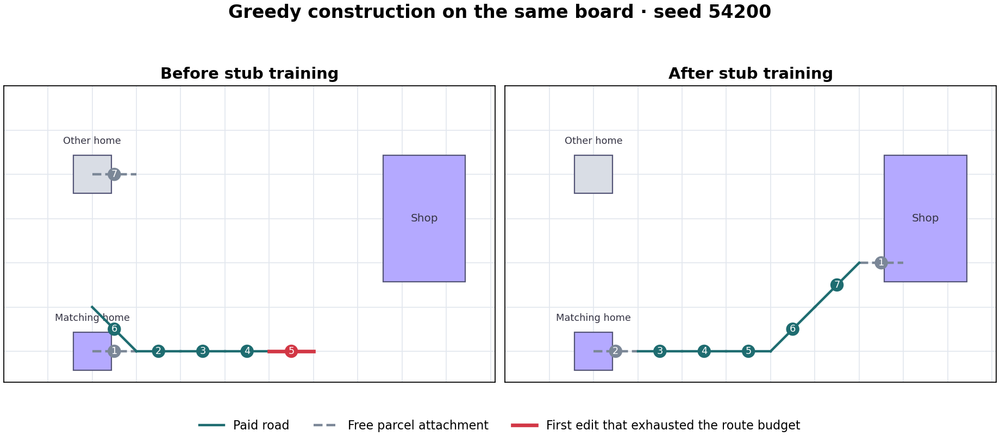
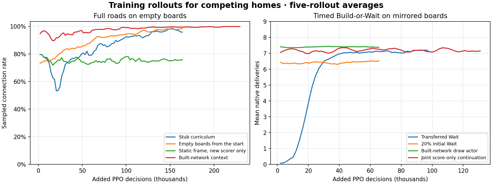

# Competing homes with the original road budget

The user authorized an hour to diagnose and train empty-board routing with competing homes. The active checkout is `/home/mohammadjaffal/mini_motorways` on `mohammad`. The earlier [construction session](../reward-only-construction-hour-2026-11-20/README.md#learned-selection-between-competing-homes) verified choosing the right prebuilt branch through three missing links. Its empty-board run scored 91/100 and 84/100 sampled on fresh mirrored tests and zero in greedy mode. Those checkpoints are the preserved baselines.

## Frozen stock audit

[Archived actions](../reward-only-construction-hour-2026-11-20/runs/triad-full-ppo-hour-01/fresh.json) were replayed in the original native host on seeds 54200–54299 in both color assignments. The diagnostic computes a lower bound on paid road units still needed to get between the serviceable home and destination. It respects visible parcel approaches, credits existing links and free parcel attachments, and relaxes diagonal conflicts and edit caps. Once the bound exceeds remaining stock, even that relaxed route is unaffordable. The calculation runs only in the audit.

On each 100-board greedy cohort the first deficit appeared at edit 3 on 15 boards, edit 4 on 34, edit 5 on 36, and edit 6 on 15. The first deficit followed a paid edit that left the lower bound unchanged in all 200 greedy cases. The greedy traces had one free edit before the first deficit. In sampled mode all 175 successful episodes preserved their stock margin; all 25 failures crossed it. The old greedy policy initially made useful progress, then built too far straight or spent a link without bringing the matching home and shop closer to a completed connection. This points to build sequencing under a tight budget.

[Raw replay traces](stock-replay.json) and [reproducer](audit_routes.py).

## Stub curriculum and comparison

An isolated [native fixture patch](triad-stubs.patch) adds two steps between prebuilt branches and empty land. First the shop and each house have short stubs. Then only the shop has a stub. Finally the existing empty-board geometry is restored. The remaining paid stock is the original span budget minus the prebuilt links needed for one branch. Thirty-two native witness boards passed the three-delivery feasibility check. The policy can build any physically legal edge. PPO gives the same terminal connection reward to any successful route and receives no witness edges or audit distances.

Two piloted variants use the same starting actor, worker assignment, layout stream and phase schedule. One restores the existing PPO weights and Adam state. The other adds a zero-output scorer for visible edge direction and displacement in the shop's coordinate frame, with the remaining road stock. This exposes spatial context for both possible homes while preserving the initial action distributions. The framed pilot updates its new scorer and the critic. The original actor and earlier construction checkpoints remain available.

The phase gate uses sampled training games. After at least six rollouts at a stage, each side needs at least 85% across the three latest rollouts to move on. A cap of twenty rollouts keeps the experiment moving to full boards. Two workers rehearse empty boards from the start and four rehearse earlier three-gap layouts. The production decision remains one native road edge or Finish.

The final gate is at least 90/100 native delivery passes on each fresh mirrored suite in both action modes, with a check of earlier three-gap repairs. Scored elapsed-time learning follows that gate.

[Stub feasibility results](stub-feasibility.json).

## Empty-board gate and transfer

The stub-only continuation passed the two phase gates and reached the planned 163,840 added decisions. A checkpoint saved after rollout 64, or 131,072 added decisions, passed **100/100 greedy** on both new color assignments and **93/100 and 98/100 sampled** on seeds 55200–55299. The earlier three-gap suite remained at 100/100 greedy on both sides and 100/100 and 95/100 sampled. This passed the agreed gate. The residual limited to relative position, edge direction and stock did less well than the stub-only architecture in the development comparison. The two variants differ in trainable parameters and optimizer initialization as well as inputs.

The same saved checkpoint scored 100/100 and 100/100 greedy and 98/100 and 97/100 sampled on the original routes from the stock audit. The replay found no greedy stock deficits. A stress test displaced one competing home closer and the other farther, using equal stock across the color swap and enough to serve either. With no learning on that fixture, the checkpoint scored 96/100 and 100/100 greedy, and 91/100 and 93/100 sampled. The native feasibility check passed on 24 boards. Forty-two pre-existing observation, mask and stock checks agreed across the original and stub hosts.



The original actor's first unaffordable paid link was parallel to the destination's driveway axis on 85/100 greedy layouts per side. The example shows a paid straight extension that leaves too few road units for the lateral turn. The selected checkpoint makes both turns within stock on that board.

[Paired edit comparison](route-variety.json) found that sampled play used a different set of paid edges on 21 of 98 jointly successful left assignments and 20 of 97 right assignments on the same layouts. This counts actual edge sets and disregards order and free attachments.

[Checkpoint evaluations](runs/triad-stub-ppo-01/), [native parity](native-parity.json), [unequal-distance fixture](triad-uneven.patch), and [route plot source](plot_route_comparison.py).

The current-road-context arm continued from a partially trained stub checkpoint. It added visible component membership and extent along each existing driveway approach. After 229,376 additional decisions it passed **100/100 greedy on both sides**, **99/100 and 100/100 sampled** on fresh mirrored boards, and **100/100 greedy**, **100/100 and 99/100 sampled** on the unseen unequal-distance fixture. The three-gap comparison held at 100/100 greedy and 100/100 and 98/100 sampled. This arm started later and updates more parameters than the static-frame pilot. [Built-network settings and raw results](runs/triad-network-ppo-01/).

## Timed Build-or-Wait

The timed task starts from the same empty board and gives the learner 18 decisions. A draw adds one legal edge at the current game time. Wait advances ten seconds. The entire reward is the native trip increment. Witness controls on both mirrored layouts scored eight trips after building and zero with Wait alone. The old and timed checkpoints remain separate.

Two starting conditions share the successful draw scorer, frozen while the timing policy learns. The first transfers the old Wait network with a small downward bias adjustment. Its initial probability of Wait on empty boards was 86.6–96.8% across 24 checked boards. The second retains the old network's representation and resets the output to 20% Wait while any draw is legal. Both receive the same native score and keep the original road stock.

The transferred Wait model completed 98,304 decisions. Fresh mirrored results were 100/100 greedy on each side with 7.44 mean deliveries, and 92/100 and 100/100 sampled with mean deliveries of 6.85 and 7.39. Frozen unequal-distance results were 96/100 and 100/100 greedy, and 93/100 and 90/100 sampled. The 20%-Wait arm learned faster at first and completed 65,536 decisions. It scored 100/100 greedy on both mirrored sides, with 6.67 mean deliveries on each, and 93/100 and 100/100 sampled, with mean deliveries of 6.20 and 6.67. Both initialization choice and training duration differ. [Transferred Wait](runs/triad-score-ppo-01/) and [20%-Wait comparison](runs/triad-score-ppo-02/).

The transferred Wait checkpoint completed all 200 greedy fresh mirrored routes before its first Wait and made zero later builds. Every one of those routes used exactly two explicit free attachment actions. A native witness could rely on automatic driveway attachment when it built the paid roads, leaving two more ten-second choices and averaging 8.69 deliveries. This reveals an achievable improvement in the 18-decision task. The witness is a diagnostic control outside policy play. [All native score controls](runs/triad-score-ppo-01/fresh-native-witness.json), [free edit breakdown](runs/triad-score-ppo-01/paid-and-free-summary.json).

The built-network draw actor gave the strongest overall timed results in the fresh paired comparisons. It transferred the learned Wait decision and froze the route weights for a 65,536-decision scored continuation. On two independent mirrored cohorts it scored 100/100 greedy and 99/100 and 100/100 sampled, with approximately 7.4 mean native deliveries. The unequal-distance test scored 100/100 greedy on both sides and 100/100 and 98/100 sampled. A frozen test with five-second waits and 29 choices scored 100/100 greedy on both sides and 99/100 and 100/100 sampled on the second mirrored cohort. That test changes both the Wait increment and the cap.

A native replay of the 100-per-side unequal-distance test checked that the policy actually chose to wait after connecting. Greedy play chose Wait on all 2,408 post-connection decisions where legal builds were still available. A hundred of the 200 greedy boards still had paid road stock at first connection. Sampled play chose Wait on 2,274 of 2,304 decisions with legal build alternatives. [Voluntary Wait evidence](runs/triad-score-network-01/uneven-voluntary-wait.json) and [audit source](audit_wait_choices.py).

### Larger frozen validation

The selected timed checkpoint was fixed before checking another 4,000 native episodes. Each row uses 500 layouts for each color assignment, replayed once in each action mode. Success means at least three scored deliveries under the original stock and 18-choice timing limit.

| Fixture family | Greedy passes | Sampled passes |
| --- | ---: | ---: |
| Mirrored home distances, seeds 65700–66199 | 1,000/1,000 | 997/1,000 |
| Unequal home distances, seeds 69200–69699 | 1,000/1,000 | 986/1,000 |
| Total | **2,000/2,000** | **1,983/2,000** |

Mean scores were 7.4115 greedy and 7.2995 sampled. Every greedy game connected before its first Wait. There were no native failures in this suite. [Aggregate and per-side results](runs/triad-score-network-01/wide-summary.json), [mirrored traces](runs/triad-score-network-01/wide-validation.json), and [unequal-distance traces](runs/triad-score-network-01/wide-uneven-validation.json).

On seeds 64600–64699, the same frozen actor averaged 7.46 in greedy play with 18 choices. Giving it two more choices raised the means to 8.73 and 8.75 on the two assignments. The 18-choice build-and-wait witness averaged 8.75 on each. This diagnostic supports a decision-slot explanation for most of the current score gap under this timing rule. The selected checkpoint uses the original 18 choices. [Extra-choice comparison](runs/triad-score-network-01/two-extra-choices.json) and [native control](runs/triad-score-network-01/fresh-second-native-witness.json).

The joint score-only continuation restored the initial timed model and Adam while training both its competing-home draw scorer and its Wait head. Four workers used unequal home distances and twelve retained mirrored layouts. It improved on the initial timed model and scored 100/100 greedy, 96/100 and 100/100 sampled on mirrored boards, and 100/100 greedy, 98/100 and 100/100 sampled on unequal distances after 131,072 added decisions. Both draws and waits received credit through native delivery outcomes. [Joint continuation and frozen trials](runs/triad-score-joint-01/) and [selected timed network](runs/triad-score-network-01/).

The 65,536-decision attachment experiment added one zero-initialized learnable logit for edges touching visible parcels. Native legality stayed identical. The learned logit rose to +0.557, favoring explicit parcel attachments. Its fresh mirrored results were 100/100 greedy and 96/100 and 100/100 sampled. Frozen development probes at −2 and −5 reduced sampled completion, and greedy mean deliveries stayed near the original witness gap. A simple action-level bias left the efficiency issue open. [Attachment training and diagnostics](runs/triad-score-attachments-01/).

## Did the stubs matter?

The equal-budget empty-board control resumed the same original checkpoint and Adam state with the same worker allocation, seeds, and PPO settings. Its targeted workers stayed on empty land throughout. On the same development cohort, both greedy sides reached 32/32 at 98,304 added decisions. The stub arm reached that observed milestone at 131,072 added decisions. The empty-only checkpoint at 98,304 passed 100/100 greedy on both fresh sides and 95/100 and 99/100 sampled, and its final sampled results were 99/100 on both sides. Continued PPO on the established parent was sufficient in this comparison. The current-network input later supported a stronger timed policy, with a different parent and training budget. [Matched control recordings](runs/triad-empty-control-ppo-01/).



The plot follows sampled training rollouts. The built-network routes and timed continuations start from more developed parents, and the joint score plot shows its mirrored training workers. Held-out performance is recorded separately.

## Checkpoints and verification

| Scope | Local checkpoint |
| --- | --- |
| Full-road routing and three-gap repair | `output/training/triad-network-ppo-01/latest.zip` |
| Native timed Build-or-Wait | `output/training/triad-score-network-01/latest.zip` |
| Joint score-only comparison | `output/training/triad-score-joint-01/latest.zip` |
| First passed milestone and rollback | `output/training/triad-stub-ppo-01/rollout-64.zip` |

Nine bounded Maskable PPO runs added 1,146,880 decisions. All training reached its configured decision cap. Fourteen existing native construction, edge policy, and observation tests passed. Both selected construction checkpoints matched the previous pair actor on 84 mask-conditioned checks outside the competing-home exercises. Relabeling two encoded colors into alternate color slots preserved the selected timed action distributions across 432 choices. That last test changes encoded input colors while replaying the same native simulation.

[Checkpoint identities and added-decision counts](LOCAL_CHECKPOINTS.json), [earlier-skill probability check](preserved-actor-distributions.json), and [encoded color check](timed-visible-color-relabeling.json).

## Replay commands

The starting revision is `6bd7f71` on the existing local `mohammad` branch. Fixture source patches and interpreted evidence are here. Checkpoint binaries, Release hosts, console logs, and full episode streams remain local under `output/training/`. The earlier [parent run report](../reward-only-construction-hour-2026-11-20/README.md) documents the previous branch and score policies.

To recheck the milestone on a separate empty-board cohort, use a fresh output path.

```bash
cd /home/mohammadjaffal/mini_motorways
PYTHONPATH=training .venv/bin/python -u training/triad_curriculum_ppo.py evaluate \
  --dll output/training/triad-stub-host-01/build/bin/TrafficHost/release/TrafficHost.dll \
  --checkpoint output/training/triad-stub-ppo-01/rollout-64.zip \
  --output output/training/triad-stub-ppo-01/recheck-empty.json --phase 0 --offset 2000
```

The scored replay entry point is `training/triad_score_ppo.py evaluate`. For the unequal-distance fixture use the `triad-uneven-host-01` Release binary and `--uneven`. Archives retain the configuration, decision counts, progress log, and selected evaluations for each run. Where saved source hashes predate later runner extensions, the archived configuration identifies that historical revision.
