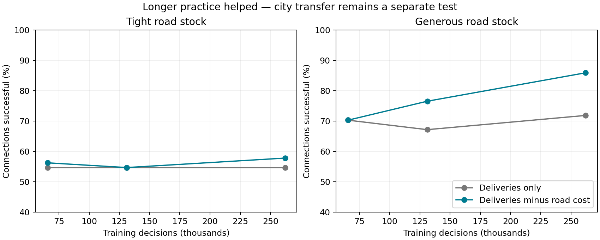

# Overnight learning follow-up —25November2026

[Decisions, research, measurements and checks](FOLLOWUP.md)

The previous longer comparison improved generous-stock connection practice, but the resulting model regressed in growing-city development games. The original remains preserved. The next bounded comparison tests continued practice versus a mix of native city episodes and practice. This is a transfer experiment, not a promise of a higher score.

The user authorized the overnight follow-up and further justified training without more clicks. No separate recurring automation was created. Follow-up is performed in the active chat; after launch the bounded controller trains, evaluates and archives autonomously.

Monitor the next run after launch:

```bash
tail -F /home/mohammadjaffal/mini_motorways/output/training/overnight-transfer-comparison-01/run.log
```

Live status will be in that output folder's `status.json` and this archive's `status.json`. It reports complete or error explicitly. Final `RESULTS.md` and `results.json` are generated after both branches and all evaluations finish. No automatic promotion or further run follows.

Model checkpoints and the compiled simulator remain local-only. Source snapshots, raw measurements, per-game evaluation records and integrity hashes are archived here. Existing files, weights and uncommitted work are preserved.



The graph uses one training seed per arm and64development games per point; it is descriptive. Source data and regeneration script are archived. City transfer failed on the separate city precheck; the graph does not establish city improvement.
