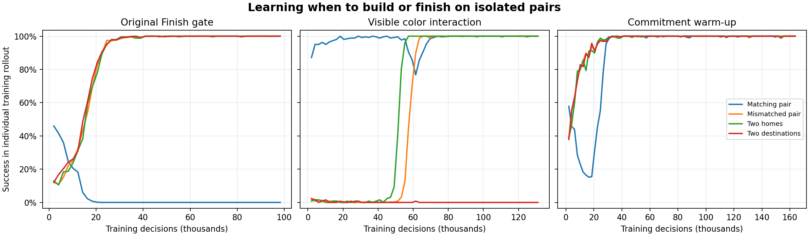

# Reward-only construction work, 20 November 2026

The user authorized a bounded session of up to one hour. Work ran in the existing Linux training checkout, `/home/mohammadjaffal/mini_motorways`. Its starting revision was `6bd7f71` on `Maskable-PPO`. The session created the local branch `mohammad` at that same revision to follow the repository instructions and kept all uncommitted work in place. The separate `main` checkout was untouched.

The session completed 12 Maskable PPO runs and 1,441,792 new decisions. Parent weights came solely from reward-trained checkpoints. Native reference routes appeared only in fixture setup and feasibility checks outside training. The construction curriculum awarded terminal connectivity or the exercise-specific no-build outcome, then measured native trips separately. The timed Build-or-Wait pilot used actual score as its complete training reward.

## Frozen obstacle transfer

The preserved [stock-only checkpoint](../reward-only-spare-stock-2026-11-20/README.md#independent-verification) transferred to the standard obstacle fixture without an obstacle training rollout. With original native stock and room for both free driveway attachments, seed range 38000–38099 scored 100/100 greedy and 94/100 sampled. A second set at 38200–38299 scored 100/100 greedy and 89/100 sampled. Every connection produced at least three native deliveries. This supports greedy transfer to the original two-block fixture and exposes a small sampling reliability gap.

Proceeding directly to harder layouts showed a distribution limit. The same road scorer, carried into the driveway checkpoint, scored 0/100 in each mode on longer three-block barriers and 0/100 in each mode on shifted-start barriers with a third blocker. The first attempt to evaluate the longer layouts exposed an out-of-bounds neighbor lookup on boards near the full native map edge. The driveway adapter now zeroes off-map neighbor entries. The obstacle evaluation was rerun with the same frozen checkpoint and layout seeds. [Per-layout outcomes](runs/obstacle-ppo-hour-01/).

## Driveway rotation

The original PPO road action space could only draw. The isolated driveway exercise gives the actor up to eight native rotation choices plus Finish. The new head sees the current driveway direction, adjacent road and links, and relative displacement to the visible destination. It learns whether and where to rotate. The road scorer was frozen, and preflight checked parity on adjacent gaps, bends, clear roads and obstacles. Its first launch stopped before training when the parity check compared CPU and CUDA tensors without transferring them to the same device. The retry corrected the check.

After 65,536 decisions in 102.50 seconds, the checkpoint corrected 75/75 wrong driveways and left 25/25 working driveways unchanged in each action mode. All 100 boards delivered at least three trips per mode. The zero-update adapter passed 25/100 greedy and 14/100 sampled. The retained road logits were checked against the parent; an earlier evaluator sampled over the expanded action array, so its exact seeded sampled trajectory differed from the old smaller array. Later evaluations sample only from legal actions to remove that source of discrepancy. [Run configuration, rollout metrics and held-out decisions](runs/driveway-ppo-hour-01/).

## Isolated color and building type

These fixtures expose Finish and the same physically legal roads even when a pair cannot deliver. The model observes role counts by visible color, in addition to the native board. A successful matching episode connects within original stock. An incompatible episode receives its terminal reward only for finishing immediately without any build. Validation uses colors 3 and 4 held out from training, plus a specific blue-home/red-destination probe using colors 1 and 0.

| Run | Change | Frozen result per 100 layouts in both modes |
| --- | --- | --- |
| Pair 01, 98,304 decisions | Original Finish head with repeated choice | 0 matching. All four incompatible groups finished immediately. |
| Pair 02, 131,072 decisions | Visible color overlap, more matching workers, lower initial Finish odds | 100 matching, 100 mismatch, 100 two homes, 0 two destinations, 100 blue/red. |
| Pair 03, 163,840 decisions | Finish choice emphasized before the first build during training, then native builds can complete the episode | 100 in each of all five groups in both modes on fresh layouts with Finish available at **every** decision. |

The first run learned to finish on nearly every scene. The second regained matching service and kept spending road on two destinations. The third changed the curriculum, worker balance and initial odds together. An intermediate checkpoint, pinned for terrain training, scored 100/100 greedy and 98/100 sampled on matching pairs, with 100/100 in every incompatible category in both modes. Both later PPO policies preserve the initial construction and driveway branches. The isolated pair decision is verified. City-level prioritization remains open.



[Settings, training measurements and frozen per-layout records](runs/).

## Competing homes baseline

Two homes share the same board and one destination. In each paired color swap only one home matches, and native stock covers one complete route. Sixty reference-only full routes across both color assignments passed the native delivery feasibility check. The frozen isolated-pair policy scored 0/100 greedy and 1/100 sampled per color assignment when building from an empty board. A diagnostic that supplied the matching home as the single geometry anchor scored the same, so choosing an anchor alone did not resolve the from-scratch construction failure. No feasibility route or matching-anchor oracle is used in PPO play.

A separate one-gap-per-branch fixture narrows the decision to which broken branch to repair with one paid road unit. Forty-eight native witness cases passed. The pair policy scored 62/100 and 38/100 greedy for the two mirrored color assignments, and 50/100 sampled in both. With the diagnostic matching anchor it scored 92/100 and 69/100 greedy, and 51/100 and 52/100 sampled. [Feasibility, paired frozen baselines and oracle records](runs/triad-ppo-hour-01/).

## Learned selection between competing homes

The new scorer conditions each legal edge on each visible home and learns a weighting from visible colors. The training reward is one for a working connection to the serviceable home. The action remains one native draw or Finish, and the parent construction and driveway scores are preserved outside the competing-home cases.

After 131,072 decisions, the learned branch scored 92/100 greedy for each of the two color swaps on seeds 56000–56099, with sampled passes of 88/100 and 96/100. Independent seeds 56200–56299 scored 100/100 for each swap in each mode. Frozen transfer to the two-gap-per-branch suite scored 100/100 greedy for each swap and 97/100 and 99/100 sampled. On the three-gap suite it dropped to 74/100 greedy for each swap and 63/100 and 60/100 sampled. When both routes had to be built from empty land, it passed 14/100 and 13/100 sampled, with zero greedy passes. [Run and cross-task measurements](runs/triad-gap-ppo-hour-01/).

The 98,304-decision continuation restored weights and Adam and mixed three-gap training with earlier-branch rehearsal. It reached 100/100 greedy for both sides of the three-gap color swap, with 99/100 and 98/100 sampled, on each of two seed cohorts. The original one-gap reference suite held at its prior greedy and sampled counts. [Three-gap continuation and independent test](runs/triad-gap-ppo-hour-02/).

The 131,072-decision full-build continuation kept original paid stock and rehearsed one- and three-gap cases. From scratch it reached 75/100 and 73/100 sampled on the original color-swap suite and 91/100 and 84/100 on fresh boards. Greedy remained at zero in all four cohorts. Every greedy episode spent its road stock and chose a draw rather than Finish at its final decision. The evidence puts the deterministic failure in build selection. [Full-build run and regression tests](runs/triad-full-ppo-hour-01/).

Two frozen diagnostics narrowed the failure. Isolating the actor's highest-weight target component failed all 100 layouts for each color swap in both modes. Sampling the first edit then using greedy actions scored 36/100 and 33/100 on the original suite; sampling the first two scored 46/100 and 52/100, and sampling the first three raised both to 63/100. The early high-probability build is part of the problem, and continued exploration helps later in the route. Use the current sampled model as the baseline when investigating deterministic build order. [Component and sampled-prefix controls](runs/triad-full-ppo-hour-01/).

## Wider obstacles and shifted starts

The terrain pilot adds visible blocked-tile positions to the existing road scorer through a zero-initialized residual. The first run trained on stubs and spare stock, then original-stock stubs and full boards with spare stock. All decisions used native legal masks. The curriculum did not reach its final no-surplus phase before the budget stopped after 262,144 decisions. Its original-stock held-out results were 100/100 greedy and 97/100 sampled on wide symmetric barriers, 46/100 and 54/100 on shifted starts, and 85/100 and 83/100 on the earlier two-block layouts. All 200 exact-stock wide and shifted test layouts had a successfully delivered native feasibility witness.

The first follow-up restored the same weights and Adam state and went directly to full original-stock layouts, favoring shifted starts. After 131,072 additional decisions, it reached 67/100 greedy and 65/100 sampled on the original shifted cohort, and 62/100 and 59/100 on an independent shifted cohort. Wide barriers held at 100/100 greedy, with 94/100 and 92/100 sampled. On fresh shifted boards, greedy success was 42/50 at a one-tile offset and 20/50 at a two-tile offset. It passed 39/50 at span seven and 23/50 at span eight. The run still regressed on the old two-block layout family with an unguarded residual, so a separate same-weight variant applies the terrain residual only to three-block fixtures. The original two-block stock-only checkpoint remains the reference.

Of the 92 fresh wide boards both modes solved, seven used different edit sets. Six of 58 jointly solved fresh shifted boards did as well. This compares whole sets of legal edits, including driveway attachments. [Original test and feasibility](runs/terrain-ppo-hour-01/) and [first follow-up and detour breakdown](runs/terrain-ppo-hour-02/).

The last continuation added 98,304 decisions at original stock and allocated ten workers to the hard two-tile shifts, equally divided by side. The guard reuses the original scorer below three blocked tiles. Packaging the guard required reloading the serialized policy with the current class, and 32 initial boards then matched the intended component's action probabilities bit for bit. Held-out shifted detours improved to 93/100 greedy and 85/100 sampled on each of two cohorts. The two-block suite recovered 100/100 greedy on both cohorts and 89/100 and 92/100 sampled. Wider symmetric detours still scored 100/100 greedy, while sampled accuracy fell to 82/100 and 83/100. Preserve the stronger wide-barrier checkpoint for that evaluation. [Final hard-offset continuation](runs/terrain-ppo-hour-03/).

## Real Build-or-Wait with score-only reward

Each action is either one paused legal draw or one ten-second native advance. The opt-in pilot gives ten decisions and two paid road units across boards with zero, one or two gaps. Unnecessary draws use a decision opportunity. The policy sees the board, time, score and remaining budget. The entire reward is the native scored-trip increment, and it gets no reward during a draw.

| Frozen policy and mode | Connected at reset | One missing link | Two adjacent missing links |
| --- | --- | --- | --- |
| Always Wait, 3-trip passes per 100 | 100 | 0 | 0 |
| Score pilot 01, single-action greedy | 100 | 100 | 45 |
| Score pilot 01, sampled | 100 | 100 | 90 |
| Score pilot 01, greedy over Wait versus total Build probability | 100 | 100 | 67 |

The no-update sampled adapter scored 100/100, 92/100 and 58/100, with mean trips of 4.74, 4.36 and 2.86. After 65,536 decisions the sampled means reached 5.99, 5.31 and 4.20. The single-action greedy model waited through all ten decisions on the 55 failed two-gap boards. Comparing Wait with the combined legal-build probability helped, leaving a real action-selection defect on 33 boards. The second pilot tests a learned correction from visible loose road ends while preserving the native score-only reward and prior actions. [Initial and scored held-out traces](runs/score-wait-ppo-hour-01/).

The follow-up added a zero-initialized, learned Wait correction from visible road tiles with one or zero outgoing links. All 12 initialization comparisons matched the previous action distributions bit for bit. After 65,536 more decisions, the second pilot achieved 100/100 on all three cases in both greedy and sampled modes, on two independent cohorts. Fresh mean native scores were 6.00, 5.32 and 4.74 greedy and 5.99, 5.31 and 4.74 sampled. This establishes Build-or-Wait on short, matched, prebuilt-road exercises with a fixed ten-decision cap. Mixed neighborhoods, longer timelines and full roads starting from empty land remain separate. [Score-only follow-up and frozen traces](runs/score-wait-ppo-hour-02/).

## Local checkpoint selection

| Use | Checkpoint under `output/training/` |
| --- | --- |
| Core construction, driveway and isolated pairs | `pair-ppo-hour-03/latest.zip` |
| Wider barriers | `terrain-ppo-hour-01/latest.zip` |
| Shifted starts at original paid stock | `terrain-ppo-hour-03/latest.zip` |
| Competing homes with prebuilt branches and up to three gaps | `triad-gap-ppo-hour-02/latest.zip` |
| From-scratch competing-home sampling diagnostic | `triad-full-ppo-hour-01/latest.zip` |
| Timed Build-or-Wait | `score-wait-ppo-hour-02/latest.zip` |

These are verified checkpoint choices for their respective fixture families. The current plan is to fix deterministic from-scratch build selection when several buildings compete for the same road budget, then reassess under scored elapsed time. [Exact local checkpoint and host identities](LOCAL_CHECKPOINTS.json).

## Sources and replay protocol

The [training history](../../../training/EXPERIMENT_HISTORY.md) indexes session decisions and the [simulator design log](../../../simulation/Docs/DESIGN_DECISIONS.md) explains the isolated fixture changes. The lesson code lives under `training/`. Each fixture patch here applies to a copy of the training checkout's existing native sources. No production native scenario files were changed in this session. A Release binary and its checkpoint weights remain local under `output/training/`. The archive keeps small per-layout and rollout measurements, fixture source patches, and exact binary/checkpoint hashes where measured. Large episode streams, build artifacts and weights remain local.

The Python entry points are `training/evaluate_construction_ppo.py`, `training/driveway_ppo.py`, `training/pair_ppo.py`, `training/terrain_ppo.py`, `training/evaluate_triad_ppo.py`, `training/triad_ppo.py`, and `training/score_wait_ppo.py`. Use the project virtual environment and `PYTHONPATH=training`. The archive includes the original driveway runner used for the exact parent source check and the saved run configurations for each later interface. The current scripts include the subsequent bounds fix, additional frozen test modes, and resume options.

For example, this replays the selected isolated-pair checkpoint on its fresh cohort with no learning. The output must be a new file.

```bash
cd /home/mohammadjaffal/mini_motorways
PYTHONPATH=training .venv/bin/python -u training/evaluate_construction_ppo.py \
  --dll output/training/paired-ppo-host-hour-01/build/bin/TrafficHost/release/TrafficHost.dll \
  --checkpoint output/training/pair-ppo-hour-03/latest.zip \
  --output output/training/pair-ppo-hour-03/recheck.json \
  --stages pair-match pair-mismatch pair-homes pair-destinations pair-blue-red --offset 200
```

The host-specific patches can be checked with `git apply --check` in the local training checkout. Build an isolated fixture with `dotnet build <copy>/simulation/Headless/TrafficHost.csproj --artifacts-path <copy>/build -c Release`. Run configurations record launch settings and rollout logs record counters. Rebuild the line graph from the archived rollout summaries with `python3 docs/training/reward-only-construction-hour-2026-11-20/plot_learning.py --output /tmp/pair-learning.png`.

Fourteen existing edge-policy, construction and visible-observation regression tests passed against the pinned native hosts. Python source compilation and fixture patch checks passed. All training completed at the configured decision limits.
