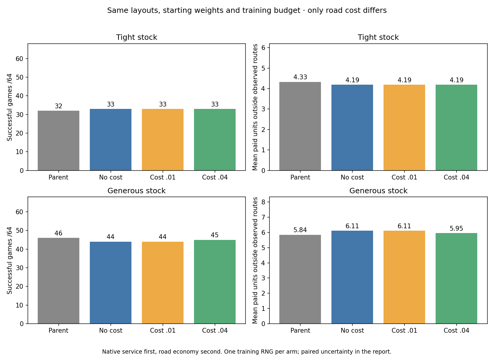

# Road-cost reward comparison — short pilot,24 November2026

## Interpretation, corrected after user feedback

**Reward wiring passed; effectiveness remains inconclusive at this short training budget.** Each arm received only16,384decisions. The user correctly challenged judging too early. These results do not demonstrate convergence, a learning plateau or that road penalties cannot work. They establish no clear benefit yet and do not justify immediate promotion. Preserve all checkpoints and Adam state for a longer matched comparison; do not discard the reward approach because these short-pilot gates were not met.

The user explicitly authorized trying a reward change after discussing messy construction. That supersedes the earlier native-only restriction for this bounded experiment. Work stayed in `/home/mohammadjaffal/mini_motorways` on `Maskable-PPO`, HEAD `6bd7f7193b26ae0f5aa12563f3dd89769115df6e` plus preserved dirty work. No planner, imitation, pull, reset, commit, checkpoint overwrite or long session was used. The Desktop/main checkout was untouched.

## Task and reward

New opt-in native fixtures isolate a single longer offset connection: `small-city-offset-single` has tight stock; `small-city-offset-stock` has generous stock. They share geometry for the same seed, have no delayed second pair, start with no connections or reference edits, and run for60native seconds. The earlier pair fixtures remain unchanged. A dispatch mistake in the initial build was found during source inspection and corrected before checks/training; unused build01 remains local, corrected build02 is used throughout.

The new `CityRoadCostEnv` wrapper returns:

`native completed deliveries − cost × newly spent road units`

Costs are0,.01,.04. There is no terminal bonus, failure penalty, teacher-based progress measure or cost on free driveway attachments. Every later delivery remains rewarded. Native traffic, action legality and native delivery score are unchanged. The wrapper checks the native ledger and rejects unexpected stock replenishment; only these finite single-connection fixtures are accepted. The old native-only trainer is untouched; a separate bounded trainer logs both native score and penalized return.

Stock is bounded by18. Thus even a one-delivery success returns at least `1−.04×18=.28`, whereas any failure returns at most0. Permanent Wait returns0. This establishes the intended episode ordering with gamma1; it does not guarantee PPO discovers the better policy. Measured feasibility witnesses have minimum successful return2.68. Test witnesses are fixed straight/diagonal fixture controls only, never training examples or policy actions. No road planner was added.

## Matched runs

All arms start from the exact same preserved whole-city initialization, keep the inherited prior frozen, and train road/Wait/spatial corrections and the critic. Same seed11424, training seed stream198000000 onward,16workers,512steps ×2rollouts, batch128,4epochs, gamma/GAE1, LR.0003, value coefficient.00001 and inherited group rates/KL safeguard. Only road cost differs. Total49,152decisions,1,536actual optimizer updates and1,302completed episodes.

| Arm | Cost/unit | Decisions | Adam updates | Episodes | Training seconds |
|---|---:|---:|---:|---:|---:|
| Control | 0 | 16,384 | 512 | 434 | 247.53 |
| Mild | .01 | 16,384 | 512 | 434 | 246.49 |
| Strong | .04 | 16,384 | 512 | 434 | 246.54 |

The220completed pre-update native episode records match exactly across all three arms, excluding time and reward/cost fields. Every recorded penalized return matches native trips minus measured spending cost. The final100training episodes average2.18native deliveries and8.08paid units in all three arms; penalized means are2.18,2.0992,1.8568. Matching these aggregate metrics does not imply identical road layouts.

## Fixed evaluation at this budget

Each stock condition uses32separate-position layouts ×2action RNGs =64games per model. Seeds199000000–031 and action RNG251000+j×100+i were excluded from training. Both stock conditions share geometry. Evaluation uses native scores, not penalized return. One training RNG per arm limits conclusions.

| Model | Tight success | Generous success | Tight native mean | Generous native mean | Tight outside-route units | Generous outside-route units |
|---|---:|---:|---:|---:|---:|---:|
| Parent | 32/64 | 46/64 | 1.7969 | 2.5000 | 4.3281 | 5.8438 |
| Trained control | 33/64 | 44/64 | 1.8438 | 2.3750 | 4.1875 | 6.1094 |
| Cost .01 | 33/64 | 44/64 | 1.8438 | 2.3750 | 4.1875 | 6.1094 |
| Cost .04 | 33/64 | 45/64 | 1.8438 | 2.4219 | 4.1875 | 5.9531 |

Mean paid units are7.046875tight and10.359375generous for every model. No evaluation episode has zero build actions. Strong-cost failed generous cases have mean remaining stock0, so these data show no collapse to permanent Wait. They also show no reduction in total construction at this budget.

Against the trained control, the stronger cost changes generous success by+1/64 (paired95% interval−3.125..+6.25percentage points), native mean score by+.046875 [−.09375,+.1875], and outside-route units by−.15625 [−.671875,+.28125]. The mild arm has zero paired differences for these metrics. Intervals use12,000bootstrap resamples of32layout clusters, retaining both action streams, RNG241127. They describe this fixed training run, not variation across training RNGs.

On40generous cases where parent, control and strong all succeed, mean outside-route units are1.375,1.35,1.35 respectively. This subgroup is descriptive and does not establish a causal economy gain. Outside-route units count paid links not seen in an assigned vehicle route during the60swindow; they are not a reward term or proof of permanent uselessness.

Neither penalty meets the predeclared immediate-promotion gates: no fewer successes than parent/control in each condition, ≥10% lower generous outside-route construction with a positive paired savings interval, and preserved native score. That is a decision not to promote **now**, not a decision that longer training cannot work. No fresh confirmation or city evaluation was run for these short candidates.

## Policy and replay checks

All512optimizer updates per arm are saved. All tensors are finite; changed entries are restricted to allowed strategy/critic tensors. Each arm changes82state-dictionary entries, including aliases, while inherited prior tensors remain identical. Both penalty arms also differ from the control in82entries, confirming the reward affected optimization.

On16shared opening observations, mean conditional-road total variation versus initialization is.001298/.001330/.001423 for control/mild/strong. Mean full action-distribution total variation versus trained control is.00003374 for mild and.00013039 for strong: about.0034% and.0130%probability redistribution. These are small changes on this sampled set, not an accuracy measure or proof of inability to learn with more updates.

The replay anchor was selected from the parent baseline before candidate evaluation: seed199000001/action251001, both stock conditions. Parent fails with tight stock after spending10units; with generous stock it spends18units, delivers3trips and leaves10paid units outside observed routes. The strong candidate still spends18 and delivers3; its corresponding outside-route count is9. This selected case alone is not evidence of a penalty benefit. Eight replay results match their evaluation records exactly. Parent/strong generous frame sheets and the comparison graph were visually inspected; HTML uses the existing template, with no browser-rendering claim.

[Parent generous replay](watch-parent-generous/replay.html) · [Strong generous replay](watch-strong-generous/replay.html) · [Parent frames](watch-parent-generous/frames.png) · [Strong frames](watch-strong-generous/frames.png).

## Validation and preserved evidence

- 104existing native simulation suites pass.
- 192feasibility/Wait controls pass across costs, stock conditions and position splits; exactly two buildings persist throughout, reward ledgers match and successes beat Wait.
- 304shared transitions preserve native state/observations/masks across costs;308older pair-fixture transitions match the previous host.
- Two focused reporting/wide-policy tests and syntax checks pass. All episode ledgers, pre-update parity, allowed tensor changes and replay equality pass.
- No road penalty was added to ordinary city rewards. This18-unit finite-task ordering must not be assumed to hold unchanged in an unlimited growing city.

`PLAN.md` records the original design and user's correction. `results.json`, `evaluation/`, `policy-audit.json`, preflight/parity logs, `measurements/`, scripts, graph and replay traces preserve the small evidence. `runtime-source/` freezes the actual Python runtime; `native-source/` records final native sources. `local-artifacts.json` and `manifest.json` record hashes. Weights/native binaries remain local-only.

Final checkpoints under `output/training/road-cost-reward-fit-01/`:

- `control/final.zip`: `8b27ff666977cfde28817d199c1049916287f08e803d7da0e298ac102f0d7ab5`.
- `mild/final.zip`: `9705db90e603a577694661269c6ba2bdbf33a0beb41142aac6affbeb37568c6a`.
- `strong/final.zip`: `65129744d8788a7a65676801a008ded2c3bdebc4382460a633adea0dd88cf8b6`.

The original parent SHA remains `7eb605e4e465b9143e095e367abe0a01285b8ace05843aaac80bd48b5f049027`. All experiment jobs ended and all checkpoints/Adam state are preserved.

## Longer comparison proposed, not started

The user's timing criticism is accepted. Continue the existing control and.04checkpoints under matched settings, measuring native success, road use and penalized return across equal decision checkpoints. A cumulative~100k/arm is roughly45–60minutes additional;~250k/arm is roughly2–2.5hours at measured speed including evaluation. These are estimates, not guarantees. Judge trends and eventual plateaus rather than treating this single early budget as a verdict. No duration was selected and no extended run has started; promotion still requires reliable behavior and subsequent retention checks.
