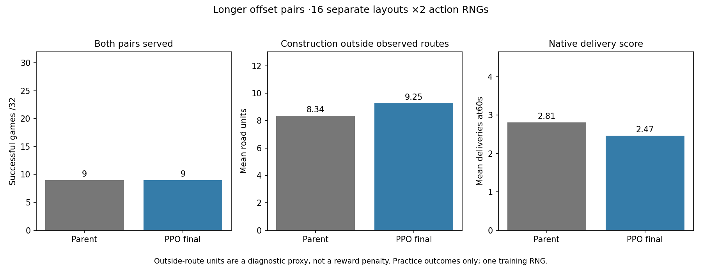

# Small-city service experiment — completed 24 November 2026

## Outcome

**The overbuilding problem is not fixed.** The parent already passes the easy straight two-pair lesson; the longer offset lesson exposes a genuine failure, but this PPO trial does not repair it. The apparent full-city development gain does not reproduce convincingly on fresh cities. Do not promote the final checkpoint, increase lesson complexity or launch long training from this result. Preserve the parent and both experiment checkpoints.

User authorized small, varied cities with limited stock and a later second connection, using native delivery reward, no planner and no imitation. Work stayed in `/home/mohammadjaffal/mini_motorways` on `Maskable-PPO`, HEAD `6bd7f7193b26ae0f5aa12563f3dd89769115df6e` plus preserved dirty work. The Desktop/main checkout and earlier checkpoints were not changed. No pull, reset, commit or long run occurred.

## What changed

Added `simulation/Assets/Simulation/SmallCityPractice.cs` and opt-in dispatch in `ConstructionCurriculum.cs`, plus `small-city` / `small-city-offset` stages in `training/city_curriculum.py`. Existing default lesson lists remain unchanged for older tools/hosts.

- `small-city-single`: one home/destination, no existing road connections, 3–5 forward-cell geometry, varied cardinal orientation, translation and color, with 0–2 spare road units.
- `small-city-pairs`: the same initial pair, plus a different-color pair appearing 18–30 seconds later. Initial stock covers two feasible connections plus 0–2 spare units.
- `small-city-offset-pairs`: longer 6–9-forward/2–4-lateral-cell connections, diagonal house approaches, and a later second pair. This is an offset/bent connection task, not an obstacle task.

All use native placement, road legality, traffic, demand and delivery reward. No road plan or reference edits are provided to the learner; initial connection arrays are empty. The future parcel/color/time is not added to policy observations. Native placement can fail if the policy builds over a future parcel; absent later service counts as failure. There is no hidden repair or bonus for waiting/building/conserving. The episode ends after 60 seconds without weekly replenishment. Forced Wait compression preserves native reward and events; finite practice windows terminate without bootstrapping a later city state.

The older reserve lesson started in a partly built, already working network. This lesson requires the initial connection from scratch. Native straight/diagonal feasibility witnesses exist only in archived test scripts; no search, teacher trajectories or labels enter PPO. The same policy learns road/Wait corrections and the critic; inherited prior tensors stay frozen. It is not a new road planner.

## Runs and why the plan changed

| Run | Saved added decisions | Actual updates in saved checkpoint | Episodes at save | Training time at save | Outcome |
|---|---:|---:|---:|---:|---|
| Easy small-city pilot | 8,192 | 256 | 212 | 118.16s | Intentionally stopped after parent baseline was already at ceiling |
| Longer offset-pair pilot | 32,768 | 1,024 | 882 | 534.98s | Completed, failed practice gates; not promoted |

The first baseline ran alongside initial training and showed both pairs served in **64/64** easy games across training-position and separate-position fixtures, and single-pair service in another **64/64**. The planned +10 percentage-point success gate was impossible at that ceiling. The first checkpoint was preserved and the remaining easy trial stopped. SIGINT did not end the detached trainer; its owned process group was then terminated. The launcher error is the recorded intentional stop, not a numerical training failure. Its episode log contains 302 completed episodes including partial next-rollout collection; only the saved 8,192 decisions/256 updates are claimed as checkpoint progress. The easy candidate was not subsequently promoted or fully evaluated.

The offset baseline and feasibility checks completed **before** its launch. Both-pair success was 8/32 on training-position evaluation fixtures and 9/32 on separate-position fixtures. This supplied a meaningful learning gap. Training restarted from the exact original whole-city zero-residual initialization, not from the stopped easy checkpoint. All checkpoints remain available.

Offset PPO: 16 workers ×512 steps ×4 rollouts; LR .0003, inherited Wait/road/spatial/value relative rates 1/.3/.1/.1, gamma/GAE1, batch128, four epochs, value coefficient .00001, existing KL safeguard, native delivery reward. One easy single-pair episode per two offset-pair episodes; seeds190000000 onward advance across resets. One training RNG. Settings and gates were declared before this trial's results. Each rollout completed all256 planned Adam updates.

## Practice evaluation

Each row uses 16 layouts ×2 action RNGs =32 games per policy. Training-position evaluation seeds190900100–115 were not training episodes; validation-position seeds191000100–115 also use a different translation range. Fixed paired scenarios/action RNGs, 60-second horizon.

| Offset-pair measure | Train-position parent | Train-position final | Separate-position parent | Separate-position final |
|---|---:|---:|---:|---:|
| First pair receives a delivery | 23/32 | 19/32 | 20/32 | 17/32 |
| Both pairs receive a delivery | 8/32 | 8/32 | 9/32 | 9/32 |
| Mean deliveries | 2.9375 | 2.5000 | 2.8125 | 2.4688 |
| Mean paid road units | 14.125 | 14.125 | 14.125 | 14.125 |
| Mean units outside observed assigned routes | 8.0000 | 9.0313 | 8.3438 | 9.2500 |

Easy single-pair service remains32/32 in each position split for parent and final. Separate-position later destinations appear in29/32 offset games for both; missing spawns are included in the denominator and cannot produce a false pass.

For separate-position offset pairs, paired city-cluster bootstrap (16 layouts, keeping both action streams together,12,000 draws) gives:

- Score change −0.34375,95% interval [−0.6875,−0.0625].
- First-pair success change −9.375 percentage points, interval [−18.75,0].
- Both-pair success change0; neither policy changes this aggregate success rate.
- Outside-route units change +0.90625, interval [+0.21875,+1.71875].

All three predeclared practice gates fail: no ≥10pp both-pair improvement, first-pair service is not retained, and outside-route construction increases. Outside-route units mean paid links not seen in an assigned vehicle route within the measured window; they are a diagnostic proxy, not a reward penalty or proof of permanent uselessness.

## Full-city development and fresh confirmation

All city games use native Los Angeles for up to600seconds, legal bridges, one-edge road/Wait actions and the inherited weekly-pick behavior. They are not leaderboard runs. The city evaluator uses the unchanged pre-existing bridge host, whose SHA-256 was preserved.

| Suite | Parent mean | Final mean | Parent scoring | Final scoring |
|---|---:|---:|---:|---:|
| Development set A,16 games | 126.25 | 131.19 | 15/16 | 14/16 |
| Development set B,16 games | 125.94 | 154.94 | 15/16 | 16/16 |
| Development combined,32 games | 126.09 | 143.06 | 30/32 | 30/32 |
| Fresh confirmation,32 new cities | 121.53 | 123.53 | 29/32 | 29/32 |

Development A/B use previously consumed city suites184000000–007 and185000000–007 with two action RNGs each. Their legacy JSON split names are `repeated`/`heldout`; neither is a current small-city training seed set. The paired development B difference was +29,95% interval [+6.56,+54.94], motivating confirmation, not a promotion. Combined mean paid roads increased99.125→108.78125 and outside-route units32.28125→33.5625: the development score rise did not demonstrate economy.

After freezing the final checkpoint, a new suite was declared: **196000000–196000031**, action RNGs244001–244032, one stream per city, with both parent and final evaluated. No training, tuning or checkpoint selection used these outcomes. Fresh paired mean change is **+2.00**,95% bootstrap interval **[−16.84,+20.72]** over32 cities/12,000 draws. Final wins14, ties3 and loses15 games. This does not establish a reliable score gain.

Fresh mean paid units92.53125→93.46875; outside-route units29.96875→29.0625; newly arriving targets served143→148; arrivals with zero road stock25→38. These mixed diagnostics are not evidence that overbuilding was solved. The predeclared retention gate passes on mean/scoring counts, but the practice gates fail and the fresh gain is uncertain; do not override those failures with the selected development result. One training RNG remains a limitation.

## What the policy changed, and what the replays show

The final audit finds finite tensors and changes restricted to allowed strategy/critic parameters (82 state-dictionary entries, including aliased feature extractors). Inherited prior tensors are identical. All1,024 optimizer updates are present. On32 shared observations from two preselected parent trajectories, mean conditional-road total variation is .001986 (about0.20% probability-mass redistribution), and mean Wait probability change is −.000994. This proves small policy changes, not learned strategy or improved road ranking.

The first64 audited updates have mean pre/post-clip norms approximately .02407 Wait, .02418 roads, .000036 spatial encoder and .03449 critic; clipping did not suppress them in that sample. The critic's last reported explained variance is negative (−4.46). This is an unresolved quality warning, not an isolated causal explanation for the failed trial. Merely completing optimizer steps is insufficient.

Replay anchors were fixed after the parent baseline and before candidate results:

- Seed191000100/action214000: **0 deliveries for both models**. All15roads are spent before the second pair appears; the first pair remains disconnected. Branches extend away from each other. [Parent replay](watch-parent-191000100/replay.html), [final replay](watch-final-191000100/replay.html), [parent frames](watch-parent-191000100/frames.png), [final frames](watch-final-191000100/frames.png).
- Seed191000108/action214008: **6 deliveries and both pairs served for both models**. First delivery at15seconds, later delivery at34seconds,8roads at later arrival,2paid units outside observed routes. [Parent replay](watch-parent-191000108/replay.html), [final replay](watch-final-191000108/replay.html).

All four replay results exactly match their frozen evaluation records. Their full frame sequences are not identical between models despite equal aggregate outcomes. The failed-case parent/final frame sheets and practice graph were visually inspected. HTML uses the existing replay template; no browser-rendering test is claimed.

## Checks and limits

- Each native host build passes all104 existing simulation suites (these suites alone do not prove full native parity).
- Easy and offset fixture preflights each pass128 connect-versus-Wait controls, with empty initial connection arrays, no reference edits, exact reward ledgers, valid observations, feasible later service and alternating reset/spawn isolation.
- Each host passes160 shared ordinary-city transitions against the protected bridge host. Adding offset fixtures also preserves560 easy-fixture transitions exactly across the two new hosts.
- Eight easy-fixture compression controls preserve final native state/reward; two reduce wrapper steps68→38 and68→28. Finite termination semantics are intentional.
- Two focused Python reporting/wide-policy checks pass after final changes. Replay/evaluation equality, allowed tensor changes, optimizer counts and protected artifact hashes are checked.

The geometry is still a controlled exercise: correlated pair orientations, limited distances/colors, no obstacles, only two arrivals and a finite horizon. After the final useful connection, surplus building can have no score consequence; this reward does not guarantee that every cosmetic extra road disappears. No all-tool, congestion, weekly-choice or leaderboard mastery is claimed.

## Next proposed step — not implemented or launched

Isolate **one longer offset home-to-destination connection**, comparing tight stock with the larger stock available in two-pair lessons, before returning the second arrival. First establish whether the failure follows geometry, extra inventory or later-city context; then train the failing single-connection condition and require reliable separate-layout service before increasing complexity. This is a proposed diagnostic/curriculum step, not proof of the cause or a guarantee of improvement. Do not add a planner or silently substitute imitation. Do not extend this rejected configuration overnight.

## Durable record and local artifacts

`PLAN.md` preserves original and superseding decisions. `preflight*.json`, `offset-preflight.json`, compatibility/compression checks, native/Python logs, `results.json`, `confirmation-results.json`, evaluation JSONL, replay traces, source scripts and plots preserve the small evidence. `runtime-source/` and `offset-runtime-source/` freeze both Python runtimes. `native-source/` records final native source, including preserved easy behavior and the opt-in offset variant; the exact separately built host binaries remain local-only. `local-artifacts.json`, `source-context.json` and `manifest.json` record hashes and provenance. No weights or generated binaries are copied into documentation.

- Parent: `output/training/city-whole-initial-01/start.zip`, SHA-256 `7eb605e4e465b9143e095e367abe0a01285b8ace05843aaac80bd48b5f049027`.
- Easy saved checkpoint: `output/training/small-city-service-fit-01/ppo/checkpoint-000008192.zip`, SHA-256 `b06f9d29647a7ba81558857474452760e2e27ad70863f1a9da7aaff32eb5ec02`.
- Offset final: `output/training/small-city-offset-fit-01/ppo/final.zip`, SHA-256 `8bfe05d67d7b9a0738ea97e23d45aefd6cdbefe64b15882076951a197901ab77`.

All training, evaluation and replay jobs have ended. No long session is running.
