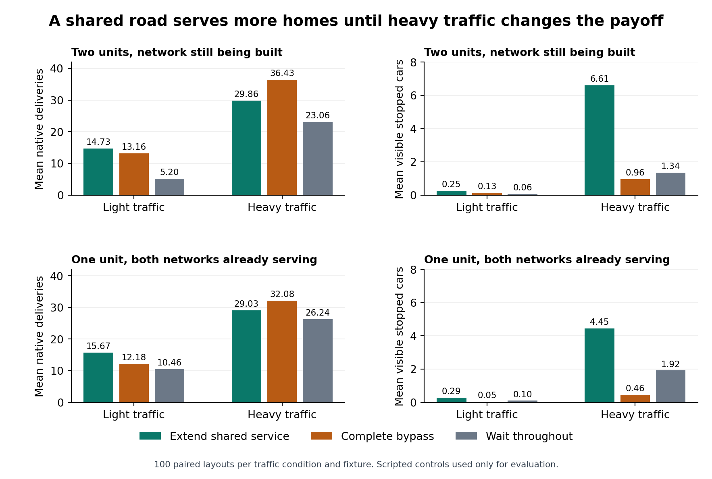

# Demand priority and congestion milestones

The user authorized work on the curriculum and extended the session to two hours. Work runs in the existing `mohammad` branch. The earlier competing-home checkpoints remain available. This session uses opt-in copies of the native Release host under `output/training/`.

## Choosing between two serviceable pairs

Two matching home–shop groups begin with a road missing one paid edge. One road unit can close either gap. A paired color-and-demand test uses the same geometry and swaps which destination displays demand. Three homes feed each group's road. The policy can draw any native legal edge or Wait. Actor input consists of visible parcels, road links, demand, traffic movement and the game clock. Reward is the number of native trips scored in the interval.

The first fixture revision put the shop entrance on the wrong side of the road and scored zero on all controls. The Release fixture was rebuilt with west-facing entrances and both corridor controls then served the intended shops. On 48 paired seeds per variant a fixed route averaged approximately 8.1–8.3 deliveries and frequently left the higher-demand storefront to fail. Waiting throughout scored zero. The reward-only Maskable-PPO runs initialized fresh weights for the new two-destination observation space. Named fixture edits are used for validation only.

## Shared junction controls

The second fixture starts one corridor in service and lets the policy connect the other group through the same junction or by an independent corridor. After 18 seconds of native warmup, any prior deliveries are excluded from the measured decision reward. Both edits cost one unit. On 32 heavy-load layouts the shared route averaged 26.94 deliveries and 1.80 visible stopped travel cars at the sampling times. The separate corridor averaged 29.44 deliveries and 0.25 stopped cars. Under the first light-load setup the two roads were effectively tied, with 6.47 and 6.66 mean deliveries. Since a single policy could do well by selecting separation in both cases, the next fixture revision changed the geometry and loads to produce a clear tradeoff.

The stopped-car measure counts visible outbound and returning cars below 0.22 simulator speed units at fixed Wait samples. It is a queue proxy. Native mean accumulated waiting and per-destination trips are also retained. The reward stays native trip score. The fixture-only source adds a delivered-trip count per destination for evaluation. Surrounding land closes other corridors physically; the actor's mask is the native legality mask.

[Native fixture patch](priority-and-junction.patch) and [detour calibration patch](junction-calibration.patch).

## Frozen priority gate

The evaluation used 100 seeds in each demand assignment (76500–76599), with the same board paired across the assignments. Both preparation controls and frozen PPO use actual native trips. A correct first commitment is confirmed when the shop that starts with four pins receives service from the built network. All three policies are Maskable-PPO from fresh weights and use native score only.

| Policy | Model decisions | Higher-demand shop served, greedy | Higher-demand shop served, sampled | Mean trips, greedy | Mean trips, sampled |
| --- | ---: | ---: | ---: | ---: | ---: |
| Shared edge features | 32,768 | 163/200 | 160/200 | 11.76 | 11.52 |
| Visible existing components | 32,768 | 200/200 | 191/200 | 13.70 | 13.21 |
| Learned link-to-demand interaction | 24,576 | 200/200 | 196/200 | 13.70 | 13.49 |

The selected checkpoint is `output/training/traffic-priority-demand-01/latest.zip`. This policy trained over 60 simulated seconds per episode and was scored over 100 seconds on held-out boards. The added demand interaction begins at zero and PPO learns its coefficient from trips. It associates visible demand with a property's **already connected** road component. No planned roads, target actions, or heuristic rewards enter the optimizer. The test establishes priority selection with one paid road unit and two one-edge completions. It leaves construction and scheduling across several unbuilt routes open.

[Held-out native controls](measurements/traffic-priority-heldout-controls-01.json) · [Frozen baseline](measurements/traffic-priority-ppo-heldout-01.json) · [Frozen component policy](measurements/traffic-priority-roots-heldout-01.json) · [Frozen selected policy](measurements/traffic-priority-demand-heldout-01.json).

## Choosing between capacity and coverage

Holding the second flow fixed while varying first-flow demand made the original shared-versus-independent choice easier to interpret. Extending the detour eventually gave the shared route a slight low-demand advantage. The two-unit stock case made the competing use of resources explicit. One action opens the shared path, followed by a feeder serving three more homes. The competing bypass needs two legal paid edits. A short enough bypass gained enough trips under pressure to reverse the preferred choice. These are physical costs and native delivery outcomes; the reward stays the score.

| 100 held-out boards per condition | Light trips | Light stopped | Heavy trips | Heavy stopped |
| --- | ---: | ---: | ---: | ---: |
| Shared route and feeder | 14.73 | 0.25 | 29.86 | 6.61 |
| Two separate-route links | 13.16 | 0.13 | 36.43 | 0.96 |
| Shared route alone | 9.65 | 0.25 | 28.37 | 3.61 |
| Wait throughout | 5.20 | 0.06 | 23.06 | 1.34 |

A second junction makes the issue a live network decision with one remaining unit. Both flows are already sharing the junction. A rising-demand board changes one destination's native demand multiplier between simulated seconds 16 and 20. The first policy phase starts at 36 seconds, so it can see ongoing traffic and both options. The policy can extend the shared feeder, close a bypass that cars can then use, or Wait. On 100 fresh boards per condition, extending the feeder beats the bypass by 3.49 trips at light demand. Closing the bypass beats extending the feeder by 3.05 trips after the surge and reduces visible stopped cars from 4.45 to 0.46. Native game-over also matters. In the high condition, 5 feeder, 9 bypass and 30 all-Wait replays ended early. Trips through game-over count as scored.

The pre-surge controls began at second zero. Starting both branches at seconds 0, 25 and 35 established the cost of delaying expenditure. The first 20 paired seeds returned 23.85 light trips with the feeder at 25 seconds and 44.65 high trips with the bypass at 25 seconds. Use of that delayed choice depends on a reliable cue. Always building the feeder at time zero averaged 33.70 across the balanced regimes. The 25-second matched decision averaged 34.25 assuming correct choices. The margin is only 0.55 trips, so it remains an exploratory test.

[Detour calibration](measurements/traffic-junction-calibration-01.json) · [First stock geometry](measurements/traffic-junction-economy-controls-01.json) · [Shorter bypass comparison](measurements/stock-short-test.json) · [Pre-surge timing controls](measurements/live-delay-controls-01.json) · [Live fixture at scale](measurements/traffic-live-heldout-controls-01.json).

The archived host changes are sequential. Start with the [competing-home fixture host](../competing-homes-2026-11-20/README.md#replay-commands), then apply [priority and junction](priority-and-junction.patch), [detour calibration](junction-calibration.patch), [stock economy](junction-economy.patch) and [live junction](live-junction.patch) within isolated copies. The later [junction variation](varied-junction.patch) moves the missing bypass link and provides an additional mirrored case using the native east-facing shop layout. Its source and controls allow a structural transfer check.



For the held-out live boards, bypass completion in heavy traffic raised shop A's mean deliveries from 17.77 to 21.53. Shop B went from 11.26 with the expanded feeder to 10.55 with the bypass and fewer connected homes. The total still rose, consistent with relieving shared congestion. In the physical passage check, 44 distinct per-layout cars serving shop B were sampled in motion along the bypass link over 12 heavy boards when it was open. None crossed when the remaining unit went to the feeder. Existing vehicle routes and next-lane data are available to this offline audit and excluded from actor features.

The stronger surge variant adds two connected homes to the first flow and increases its demand after the cue. On 24 paired seeds beginning at time zero, the 25-second adaptive control averaged 38.38 trips across the two conditions. The best fixed action at time zero averaged 37.48. The difference is about 0.90 native deliveries, leaving a small margin to learn the value of waiting. The timing PPO branch began at second 15 with normal legal builds and five-second Wait. Its parent came from the one-unit live run. A one-time Wait logit increase broadened exploration of delays. The reward and native legality did not change. Pre-surge paired native observations have identical legal masks and visible model inputs through second 15. The audit checks this without reading the latent surge schedule.

[Physical passage and early probability probe](measurements/live-intermediate-01-cues.json) · [Stronger surge controls](measurements/traffic-surge-rush-controls-01.json) · [Stronger surge fixture patch](surge-sensitivity.patch) · [Figure source](plot_controls.py).

## Three serviceable destinations

A separate practice board adds a third destination and matching home group. Native stock covers two of the three one-edge completions. The visible initial pins are 0, 2 and 4. A paired role rotation changes which shops display these levels. All three destinations appear in the model observation, along with their current reachable road components. With 36 validation seeds per role assignment, the named choices serving both higher-demand shops averaged 21.99 trips and survived on all 72 boards. The choice omitting the highest-demand shop averaged 9.04 and ended all 72 replays early. The first experiment uses the same demand interaction as the two-pair lesson, trained from fresh Maskable-PPO weights.

[Three-pair native controls](measurements/traffic-priority-three-controls-01.json) · [Three-pair fixture patch](three-pairs.patch).

## Two-unit allocation outcome

`traffic-stockrush-ppo-01` ended at its 36,864-decision budget. With the original two units available on seeds 79300–79399, the model spent them on shared service and the feeder in 94/100 light greedy and 89/100 light sampled replays. In heavy traffic, it completed the two bypass links in 100/100 greedy and 98/100 sampled replays. Mean deliveries were 14.66 light and 36.43 heavy in greedy play, and 14.48 light and 36.16 heavy in sampled play. Heavy greedy matched the scripted optimum among the named controls and averaged 0.96 stopped cars. This measures the value of two sequential choices on the supplied junction network.

[Model run and settings](runs/traffic-stockrush-ppo-01/config.json) · [All frozen layouts](measurements/traffic-stockrush-heldout-eval-01.json).

## The policy reacted to live congestion

`traffic-live-ppo-01` finished after 36,864 decisions. An early 7,680-decision checkpoint chose the feeder across both regimes in greedy play and showed little change when its traffic observation was swapped. An intermediate 19,968-decision checkpoint started choosing the bypass on heavy layouts. The final checkpoint was evaluated from second 36 on 100 held-out boards per regime (78900–78999).

| Frozen policy | Light feeder | Mean light trips | Heavy bypass | Mean heavy trips | Mean heavy stopped cars |
| --- | ---: | ---: | ---: | ---: | ---: |
| Greedy | 100/100 | 15.67 | 100/100 | 32.04 | 0.48 |
| Sampled | 91/100 | 15.37 | 94/100 | 31.84 | 0.69 |
| Fixed feeder control | 100/100 | 15.67 | 0/100 | 29.03 | 4.45 |
| Fixed bypass control | 0/100 | 12.18 | 100/100 | 32.08 | 0.46 |

Both policy modes had nine native early endings in heavy traffic and zero in light traffic. Greedy waited at least one interval after second 36 on seven heavy boards before opening the bypass. The score and stopped-car averages include those games. This run establishes allocation after observing existing traffic and stays within the single-junction practice scope.

On 40 new paired snapshots, the final policy's initial mean bypass probability was 10.35% under light traffic and 75.88% under heavy traffic. Replacing only light vehicle counts, movement, speed and queue channels with the heavy snapshot raised it to 61.03%. Replacing only visible pins and warnings raised it to 43.25%. Feeding both light groups into the heavy snapshot returned probability to 10.35%. Geometry, legal masks, stock and the model weights were identical across each pair. This is a frozen-input sensitivity check. It supports the use of actual movement features as well as demand pins. The full native trajectory comparison above measures throughput and queues.

The same checkpoint transferred poorly when the gap moved or the roads faced the other way. On 24 combined mirror-and-shift boards in heavy traffic it chose the bypass once greedily and eight times when sampled. The greedy mean was 29.33 trips against 32.12 for the native bypass control. The interrupted continuation rehearsed the original, the mirror alone and the shifted gap alone, with the combined change held out.

[All native and policy replays](measurements/traffic-live-heldout-eval-01.json) · [Frozen sensitivity and passage audit](measurements/traffic-live-cue-audit-01.json) · [Three geometry probes](measurements/traffic-live-varied-baseline-01.json).

## Three-destination result

The three-destination run completed 36,864 decisions. On seeds 84700–84799 in each role assignment it served both higher-demand shops on 200/200 greedy and 192/200 sampled replays. Mean trips were 21.67 and 21.39, respectively. All 400 replays stayed within the original two paid units. There were zero early endings in greedy play and one in sampled play. [Frozen layouts and scores](measurements/traffic-priority-three-heldout-eval-01.json).

## What the geometry and timing probes found

A frozen coordinate control reflected the visible board, vehicle headings and legal action indices together whenever the shops were on the opposite side of the board. On pure mirrors it raised heavy greedy score from 29.29 to 32.04, close to the native bypass control at 32.12. With the gap both moved and mirrored, the same transform earned 28.75 trips. This points to a gap-location weakness alongside the orientation weakness. Inspection of the four fixture variants showed that the bypass joined two visible degree-one endpoints on existing roads. A fresh road-end feature pilot started with that interaction initialized to zero. Only its initial checkpoint and configuration were written. [Frozen reflection replays](measurements/traffic-live-reflection-control-01.json) · [Diagnostic source](diagnose_symmetry.py).

The five-second timing arm's frozen intermediate still scored 47.97 trips in heavy greedy play, with 4.82 stopped cars. It had not reliably discovered waiting for the surge and then opening the bypass. The held-out scripted comparison scored 52.88 heavy trips when opening the bypass at second 25 versus 48.55 with the feeder at second 15, and supports further timing work on this fixture. The 20-second Wait arm tested whether one voluntary advance across the surge improved exploration. Each timing arm preserved a later checkpoint at the interruption. Those later checkpoints have no frozen result. [Intermediate policy replays](measurements/pre-surge-intermediate-01-frozen.json) · [Matched timing controls](measurements/traffic-pre-surge-heldout-controls-01.json).

There are separate verified checkpoints for demand priority and congestion. The first integrated two-destination policy started from the live congestion checkpoint, which averaged 8.44 greedy deliveries on the separate priority probe. The mixed continuation improved its online priority averages in the first three completed rollouts, and its frozen results are unavailable. [Frozen prior probe](measurements/traffic-integrated-priority-initial-01.json).

## Run ledger and local state

| Run under `output/training/` | Added decisions saved | Outcome |
| --- | ---: | --- |
| `traffic-priority-ppo-01` | 32,768 | Plain edge baseline reached 163/200 greedy and 160/200 sampled |
| `traffic-priority-roots-01` | 32,768 | Existing road components improved reliability |
| `traffic-priority-demand-01` | 24,576 | Selected two-destination priority checkpoint |
| `traffic-live-ppo-01` | 36,864 | Selected live-junction checkpoint within the original geometry |
| `traffic-stockrush-ppo-01` | 36,864 | Selected two-unit coverage-versus-capacity checkpoint |
| `traffic-live-relation-01` | 43,008 | Wall budget, additional same-component scorer, heavy online mean 29.36 at the last rollout, frozen evaluation unavailable |
| `traffic-priority-three-ppo-01` | 36,864 | Selected three-destination priority checkpoint |
| `traffic-pre-surge-ppo-01` | 23,040 | Interrupted, five-second Wait, frozen intermediate archived |
| `traffic-pre-surge-longwait-01` | 10,752 | Interrupted, 20-second Wait |
| `traffic-live-varied-ppo-01` | 15,360 | Interrupted, trained on three geometry variants and withheld their combined variation |
| `traffic-integrated-ppo-01` | 4,608 | Interrupted, rehearsed demand priority and live congestion together |
| `traffic-live-endpoints-01` | 0 | Interrupted during the first rollout, initialization only |

Interrupted runs have no terminal status record. Their decision counts come from completed updates in the progress stream. The user-authorized work window has elapsed. The post-interruption process check found no active native trainer or simulator. Weights and compiled hosts remain local. The main playground checkout and prior checkpoints were left in place. Source hashes in each configuration identify the launch-time version. A compatibility check reproduced 16 earlier frozen priority outcomes after the runner was generalized to three shops. The existing 14-test suite passed. Observation shape, legal mask and stock checks passed on 32 layouts covering the two- and three-shop exercises and junction variants.

Run records use the inherited `PPO ... connected` line for positive trial score. Per-stage `TRAFFIC` lines are mean scored trips by regime. For frozen reproduction in the training checkout:

```bash
cd /home/mohammadjaffal/mini_motorways
.venv/bin/python training/traffic_ppo.py evaluate --exercise junction \
  --stages traffic-junction-low-live traffic-junction-high-live \
  --dll output/training/traffic-live-junction-host-01/build/bin/TrafficHost/release/TrafficHost.dll \
  --checkpoint output/training/traffic-live-ppo-01/latest.zip \
  --output output/training/traffic-live-replay-new.json \
  --horizon 120 --warm-seconds 36 --wait-ticks 100 --offset 900 --count 100
```

The immediate training question is whether the actor can pick the bypass on changes in both geometry and timing. A growing city with several evolving networks remains a later milestone. It needs broader observations and an action interface that can expose new decisions when construction stock or parcels appear.
