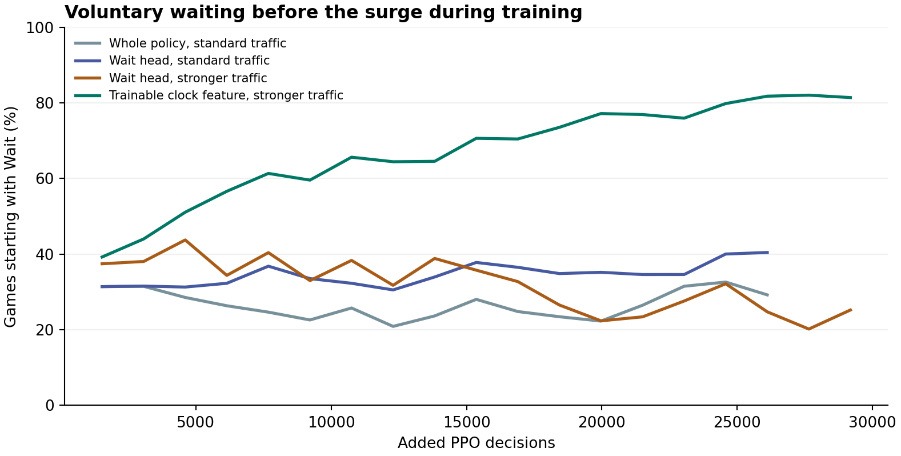

# Learning to wait before traffic changes

The user delegated one hour to advance the traffic curriculum. The training checkout is `/home/mohammadjaffal/mini_motorways` on `mohammad` at `6bd7f71` with local changes. The starting policy is the [selected road-end checkpoint](../road-end-transfer-2026-11-21/README.md#selected-checkpoint), which can open an unfamiliar bypass gap when it starts after the surge.

## Experiment

Both networks start connected over the shared road. The actor begins at simulated second 15 with one paid road unit. It can build one physically legal edge while paused or choose a 20-second Wait. The light and future-heavy pair has the same visible state and legal mask at second 15. The latter has a native demand increase between seconds 16 and 20. Spending immediately commits that unit before the increase can be observed. A Wait can reveal the new traffic, then the choices remain legal. The score is native deliveries counted after second 15 through second 140 or native game-over.

The selected parent puts about 0.7% initial probability on Wait before the surge. At second 35 the unmodified parent usually picks the feeder under light traffic and the bypass under heavy traffic. A one-time +4.6 Wait logit initialization makes the delay easier to explore. The same scalar applies at every state and stays trainable. A frozen replay of the biased initialization measures what that intervention does by itself.

Two matched PPO arms use the same starts, rollouts, entropy, native reward and seed stream. The joint arm updates the whole policy. The Wait-only arm holds the topology actor's road scorer fixed and updates its Wait head and critic. The original native controls show a small average benefit for waiting to decide, so a third arm rehearses two contrast fixtures with greater load at the second destination. Its training groups use native load 3.45 and 3.10 instead of 2.75. The exercise keeps the original stock and legal road alternatives, and the future surge remains invisible at the initial decision. Fixed-action and delayed native controls run outside PPO.

On the 80-seed standard validation variants, the best fixed build at second 15 averaged 36.02–36.13 deliveries across paired traffic outcomes. Waiting to second 35 and opening the condition-appropriate road averaged 36.94–37.28. The unmodified parent spent at second 15 in all greedy and sampled episodes. Its balanced average was about 35.3. The constant exploration bias sometimes delayed spending, but its frozen average was also about 35.3, so a change in action frequency alone did not establish a score gain. On the stronger contrast variants, the native advantage of delaying to second 35 grew to 1.70–1.77 trips over the best fixed early build. [Standard matched native controls](measurements/timing-holdout-cadence-controls-03.json) · [Stronger matched controls](measurements/timing-contrast-holdout-controls-01.json).

A fourth PPO arm retains the same copied topology weights and uses fresh Adam for an added two-parameter clock feature in its Wait head. Its early adjustment initializes at +4.6 and decreases linearly to zero at second 35. The later parameter initializes at zero. Both parameters and the rest of the Wait head remain trainable. The visible clock supplies the basis and the future event is hidden. This discourages the constant exploration initialization from inducing repeated Waits after the cue is visible. The model remains able to choose any legal road at any decision, and frozen initial and trained policies are compared on the same states to separate initialization from learning. [Contrast fixture](contrast.patch) · [Later surge stress-test fixture](latepulse.patch).

## Earlier starts and variable surge time

The intermediate clock policy's Wait probability at second 15 increased from about 0.40 at initialization to about 0.67 on a development fixture. At second zero it was only about 0.04. This motivated a narrower continuation on the same lesson with starting times sampled from seconds 0 through 15, a ten-second Wait and a one-time +2.5 exploration offset. It copied an intermediate clock checkpoint, kept each road score fixed and trained the timing head further. The ordinary surge is at seconds 16–20. The optional later fixture shifts the surge to seconds 24–28. Training pairs test both schedules, and the main earlier-start evaluation begins at second zero. The sampled start is represented to the policy solely by its usual visible clock and the live scene. The rush profile and geometry remain hidden.

The continuation's frozen initial weights after the exploration offset are retained, so any later gain can be compared with the same intervention before learning. Its evaluation also measures whether a policy that waits can eventually commit a useful edge. A delayed score improvement on second-15 starts establishes only the one-Wait lesson until earlier and later-surge checks support a broader claim.

## What the initial comparisons showed

Both standard runs hit their wall budgets at 26,112 saved added decisions. Updating the full policy yielded 35.30–35.66 mean greedy deliveries across the paired regimes and improved only modestly over the original checkpoint. Learning only Wait with the constant initial bias yielded 34.94–35.05 and remained below the best immediate native control. More Wait choices alone were insufficient.

In development probes the clock-separated Wait arm progressed from about 0.40 to 0.83 initial Wait probability at second 15. Its Wait probability at second 35 remained about 0.02 or below. The sampled contrast games were therefore exploring the interval before the cue without usually delaying a second interval after it. These probabilities come from frozen weights and measured observations rather than the rollout average.

The from-zero development replay of an intermediate variable-start checkpoint still spent immediately in every greedy game. Native controls reveal why the earlier opening is a harder objective. On the two standard contrast layouts waiting until second 40 offers only 0.38–0.55 more deliveries than the best fixed action from second zero, even with the preferred downstream build supplied by the native control. The 20-second scripted control leaves a larger theoretical margin and can fall before the future surge on the late schedule. That early control is an upper bound which assumes information the policy may lack at the moment of commitment.

A final finer-cadence arm resumes the clock policy from an intermediate saved checkpoint, maintains the frozen road scorer, and uses five-second Wait from second 15. It rehearses both normal and late pulses, with a one-time +0.8 exploration increase. This tests whether repeated decisions support waiting for the cue without paying unnecessary delay on earlier pulses. The held-out normal and late cases use matching seeds and identical pre-surge states. [Standard joint replays](measurements/timing-joint-final-02.json) · [Standard Wait-only replays](measurements/timing-wait-only-final-03.json) · [Clock development snapshots](measurements/timing-clock-dev-probe-02.json).

## Learned to hold the road unit before the normal surge

The clock-based Wait run saved 29,184 new decisions at its wall limit. On 320 unseen stronger-traffic layouts beginning at second 15, its greedy policy waited first on 316 boards. It built the condition-appropriate road at second 35 on 311 boards. The same actor's frozen exploration initialization waited on 134/320. Its balanced greedy score rose from 36.96 to 38.14 trips per game, compared with 36.59 for the best fixed early commitment per geometry and 38.33 for the scripted delayed choice. Sampled play averaged 37.58 trips. It waited initially on 254/320 boards and made the preferred choice at second 35 on 236/320.

On 320 standard-traffic transfer boards, greedy play averaged 36.72 against 36.08 for the best fixed early commitment per geometry. Sampled play averaged 36.14. The original post-surge road skill remained available on the held-out middle gap. The retention test at second 36 averaged 31.89 and 31.87 heavy greedy deliveries in the two orientations and preserved the light feeder score on both.

A surge at seconds 24–28 exposed a limit. The same actor waited on all 100 later-surge test boards greedily, but chose the heavy bypass at second 35 on 33 of the 50 heavy replays. Its balanced score was 35.66 versus 35.80 for the best fixed early control and 37.21 for the scripted delay. This points to a road-selection failure just after a later cue. A final focused run practices route decisions at seconds 34–39 across ordinary and late pulses while holding the trained Wait head fixed. It will be checked again from before the surge.



The curves show first-action waiting in on-policy rollouts. The clock arm and two simpler intervention arms preserve the deployment road scorer. The separate standard arm trains the whole policy. The runs also differ in traffic regimes and optimizer initialization. The figure reports practical comparisons and cannot isolate every contribution. [Contrast outcomes](measurements/timing-clock-final-01.json) · [Standard transfer](measurements/timing-clock-standard-transfer-01.json) · [Late transfer](measurements/timing-clock-late-transfer-01.json) · [Post-surge retention](measurements/timing-clock-post-surge-retention-01.json).

## Starting at second zero

The variable-start continuation completed 24,576 added decisions at ten-second Wait cadence. In frozen greedy play it spent the unit immediately on all 256 standard-time contrast boards and all 128 later-pulse boards. On ordinary pulses, sampled play spent immediately on 168/256 boards. Its balanced sampled means of 37.82 and 38.55 were below the corresponding best fixed controls at 38.41 and 39.27. The weaker early information and smaller measurable return advantage remain open. The trained second-15 checkpoint therefore remains the reference for the normal-surge lesson. [From-zero policy](measurements/timing-variable-final-zero-01.json) · [Later-pulse from-zero replay](measurements/timing-variable-final-late-01.json) · [Normal and later pulse at matched seeds](measurements/timing-variable-final-normal-paired-02.json).

The clock policy's paired bootstrap score gain over the best fixed immediate build was +1.55 trips in greedy contrast play and +0.98 with sampling. The descriptive 95% intervals were 1.18–1.93 and 0.62–1.36 trips. On standard traffic they were 0.31–0.95 for greedy, and -0.41–0.48 for sampled. This estimate resamples seeds, keeping the paired future outcomes and both geometry assignments together. [Paired gains](paired-gains.json).

## Five-second decisions adapt to a later pulse

The fine-cadence PPO continuation completed 20,480 added decisions. In 512 held-out greedy replays starting at second 15, the policy chose Wait first every time. It chose the feeder on 248/256 light boards. It opened the bypass on 128/128 normally timed heavy boards and 116/128 later-pulse heavy boards. Both heavy geometries moved from a median first build at second 35 under normal timing to second 40 under late timing.

The pulse-timing comparison used the same seeds and road geometry on each side. On 77/128 heavy pairs, the late pulse led to a later build. Forty-four had the same timing and seven committed earlier. All 128 light pairs kept exactly the same build time when the pulse schedule was shifted, because these boards had no surge. This shows the trained actor adjusts its timing in response to the changing observation. The frozen initial checkpoint chose the heavy bypass on only 32/128 late boards greedily. It had the same trained parent and the same one-time +0.8 exploration adjustment as the final trial's starting state.

| Fine-cadence test, two held-out placements each | Best fixed early mean | Initial greedy mean | Trained greedy mean | Trained sampled mean |
| --- | ---: | ---: | ---: | ---: |
| Normal pulse, stronger traffic | 36.31 | 37.38 | 37.70 | 37.45 |
| Later pulse, stronger traffic | 35.58 | 35.68 | 36.16 | 35.50 |
| Normal pulse, standard traffic | 36.08 | — | 37.13 | 36.83 |

Sampled play on later pulses remained below the best immediate control on one geometry and approximately level on average. The original 20-second clock policy still has the strongest normal-pulse contrast score from second 15. The five-second policy is the reference for a changing cue time. [Fine-cadence replay](measurements/timing-fine-final-01.json) · [Initialization control](measurements/timing-fine-initial-01.json) · [Fine-cadence standard transfer](measurements/timing-fine-standard-transfer-01.json).

An independent earlier-start check on the original 20-second clock actor began at second 12 instead of second 15. The final actor delayed to second 32 on 148/160 greedy replays, from 12/160 at initialization, and averaged 37.82 trips against 37.23 for the best fixed early control and 36.44 at initialization. Sampled play averaged 36.95. The later-time and cold-start limits remain distinct. [Earlier-start native controls](measurements/timing-earlier-controls-01.json) · [Frozen earlier-start weights](measurements/timing-earlier-clock-final-01.json).

## Final route-head check and run ledger

Training the road scorer after the cue while freezing the clock and Wait head improved the late-pulse greedy mean from 35.66 to 36.10, slightly above the fixed reference at 35.80. Its sampled mean was 35.52. The route update reduced normal-pulse greedy means from 38.05 and 38.24 to 36.61 and 37.23 on the two geometries. The changed road logits can alter the decision even with the Wait logit fixed. Keep the five-second checkpoint for the variable-timing lesson. [Late route-head test](measurements/timing-late-road-final-late-01.json) · [Normal-pulse regression](measurements/timing-late-road-final-normal-01.json).

| Run | Added PPO decisions saved | Purpose and disposition |
| --- | ---: | --- |
| `timing-joint-02` | 26,112 | Standard traffic, whole policy, small improvement below fixed early reference |
| `timing-wait-only-03` | 26,112 | Standard traffic, fixed road scorer, below fixed early reference |
| `timing-contrast-wait-01` | 29,184 | Stronger traffic, constant exploration offset, greedy below immediate reference |
| `timing-clock-wait-01` | 29,184 | Stronger traffic, learnable clock preference, selected for 20-second Wait |
| `timing-variable-start-01` | 24,576 | Earlier random starts, cold-start gate unmet |
| `timing-fine-wait-01` | 20,480 | Five-second rounds, selected for changing surge time |
| `timing-late-road-01` | 24,576 | Route-only late-cue rehearsal, regular timing regressed |
| Total | 180,224 | Seven learning runs |

The first Wait-only process failed before collection due to class identity after checkpoint deserialization. A paired native replay was also relaunched with a corrected simulator path. Both failed attempts are excluded from reported results. Final heads passed exact tensor comparisons for the parameters declared fixed. The earlier 14-test suite passed, and both new native hosts built in Release with clean patch dry-runs. Frozen replay comparison checked host and checkpoint hashes, paired seeds, stock, per-destination delivery totals and trained fingerprints.

The checkpoints and native binaries remain local. To reproduce the selected five-second behavior from the training checkout, use a new output path.

```bash
.venv/bin/python training/traffic_ppo.py evaluate --exercise junction \
  --dll output/training/traffic-timing-latepulse-host-01/build/bin/TrafficHost/release/TrafficHost.dll \
  --checkpoint output/training/timing-fine-wait-01/latest.zip \
  --stages traffic-junction-low-live-gap4-rush-b345 traffic-junction-high-live-gap4-rush-b345 \
           traffic-junction-low-live-gap4-rush-b345-latepulse traffic-junction-high-live-gap4-rush-b345-latepulse \
  --horizon 140 --warm-seconds 15 --wait-ticks 100 --offset 20700 --count 64 --workers 8 \
  --output output/training/timing-fine-replay-new.json
```

For the coarse normal-pulse checkpoint, use `output/training/timing-clock-wait-01/latest.zip` with a 20-second Wait and the contrast host. The local [matched summary](matched-summary.json) records the rest of the controls, outcomes and per-policy timing. This work verifies timing within the supplied live junction. Stock allocation from a cold start and strategy in a growing city remain open.

### Final independent checks

With fresh seeds and an earlier second-12 start, the fine policy waited first in all 256 greedy episodes. It averaged 37.78 trips against the ordinary-pulse fixed benchmark of 36.27. When the pulse was later, it averaged 36.25 against 36.34 for the fixed benchmark. The fine policy also spent immediately from second zero on every greedy board in a separate test, confirming the cold-start limitation. In the after-surge retention replay it chose the heavy bypass on 200/200 previously unseen middle-gap layouts greedily and the light feeder on 199/200.

On 24 independent frozen snapshot pairs at the same clock time of second 37, the fine actor's average Wait probability under heavy traffic was 0.21 with the normal pulse and 0.44 with the late pulse. Its bypass probability was 0.78 and 0.43 respectively. Both scenarios had identical input and mask before the surge. This diagnostic uses observed inputs from reset-and-advance trajectories. The actual play replays above establish the actions and score consequences. [Earlier five-second replay](measurements/timing-fine-independent-final-01.json) · [After-surge retention](measurements/timing-fine-post-surge-retention-01.json) · [Normal cue snapshots](measurements/timing-fine-normal-snapshot-01.json) · [Late cue snapshots](measurements/timing-fine-late-snapshot-01.json).

### Reproduction and next open decision

A one-worker rerun reproduced all 64 coarse and 128 fine held-out replays in the selected subsets exactly, including the native scores, actions and traffic samples. [Exact replay check](reproduction-check.json) · [Actor head audit](measurements/head-audit.json).

The cold-start benchmark has a smaller native margin for delaying and requires several choices before the cue. Greedy play committed immediately from zero with both the variable-start continuation and the final fine-cadence model. A future timing scenario could pair one road that is valuable immediately with a second unit the actor can reserve for uncertain demand. That would test saving stock while the city is useful during the early interval. Any such scenario needs native controls for spending, reserving and the eventual use of the unit before interpreting policy behavior.

The final frozen substitution audit used 32 additional matched heavy boards that differed in pulse timing. At second 36 the fine actor assigned 25.5% mean Wait probability on the ordinary pulse and 46.0% on the late pulse. Substituting only the ordinary-pulse vehicle channels into the late-pulse observation dropped its Wait probability to 28.9%. Substituting only pins and warnings dropped it to 44.8%. The clock and legal moves held steady. This isolates sensitivity to visible vehicles in the frozen actor. At seconds zero and 15, the two pulse schedules produced identical policy inputs and legal masks on all 32 pairs. [Matched feature substitutions](measurements/timing-fine-cue-substitution-01.json).
