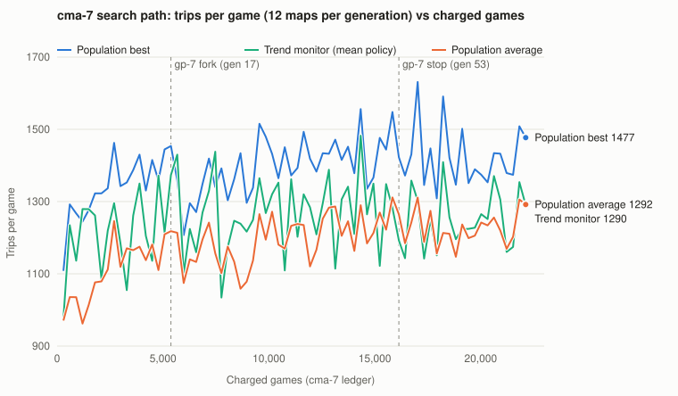

# gp-7 / cma-7: final result (2026-11-19)

The pre-registered plan is [`../../plans/2026-11-14-gp7-cma7-plan.md`](../../plans/2026-11-14-gp7-cma7-plan.md).
Run-by-run notes are in [`../../EXPERIMENTS.md`](../../EXPERIMENTS.md). The headline and secondary differences
recompute exactly from the two CSVs in `games/`. The p-values and intervals come from `stats7` (see `headline7.json`).

## Headline

**The new policy beats the previous best (L = cma-1 3-tree) by +256.5 trips per game on 900 unseen test maps.**
It is adopted as the headline.

| Policy (test maps 6100-6999, n = 900) | Mean (average) | Median | Best | Worst |
|---|---|---|---|---|
| **gp-7 final** (`e8b8b4cad3d5b71c`) | **1243.2** | 1245.5 | 2503 | 151 |
| L = cma-1 3-tree (`fa7648c7`) | 986.7 | 995.5 | 1967 | 267 |
| hand rule | 569.6 | 547.5 | 1245 | 159 |

- **Paired difference vs L: +256.5** (SD 438.0, SE 14.6). One-sided paired t = 17.57, p = 6.4e-60.
  BCa 90% interval [232.2, 280.5]; Wilcoxon one-sided p = 4.3e-58. gp-7 final scores higher on 682 of the 900 maps
  (1 tie). That is +26% over L on the same maps.
- **The test was looked at once.** The decision rule (`stats7.decide_headline`, unchanged since 4453544) was fixed
  before the runs started: the challenger with the best validation result, then a one-sided paired t at α = 0.05
  on at least 400 test maps.
- **L's usual figure, 1021.2, is its mean on the 200 maps used to choose L.** On these 900 test maps L averages
  986.7. The paired +256.5 is the number to quote.
- Validation gave gp-7 final +352.8 over L. That number only chose which policy went to the test and is not a
  result.

## What the champion is

`challengers/gp7_final.txt` is a weighted linear rule set: 3 trees (priority, hold, upgrade) over the planner's
features, plus the planner's learned cost and target weights, with lights and roundabouts off.

- **It is a cma-7 policy.** gp-7 is cma-7 plus "dynamic GP" epochs that try to insert new feature trees. No tree
  was ever inserted, so gp-7's final policy is exactly cma-7's in-bounds mean after generation 53.
- It was frozen at commit 6b80889 (tag `cma7-launch`, simulator f34, 3600 s cap). See `FREEZE.md`.

## How it was chosen

| Step | What happened |
|---|---|
| Start | x0\* = L's (cma-1's) rule weights plus the screened "Fast" planner start (lights off), chosen on 300 screen games before launch. |
| Training | cma-7: sep-CMA-ES, 24 candidates per generation, each on 12 maps. 17 shared trunk generations, then cma-7 and gp-7 side by side until the time budget ran out. |
| Stop | Both runs ended `budget` (not converged) on 2026-11-19 at 00:06-00:07. cma-7 reached gen 73, gp-7 gen 53. |
| Validation | 3 frozen challengers on maps 1550-1749 (n = 200), paired with L (mean 943.5). Means: x0\* 1091.0 (+147.5), cma-7 final 1272.7 (+329.2), **gp-7 final 1296.4 (+352.8)** → C\* = gp-7 final (`pick7.json`). |
| Test | C\* on 6100-6999, one look → headline (`headline7.json`). |

*cma-7's path. At each generation: the population average and the best candidate (12-map means), plus the trend
monitor (the mean policy) on the same maps. gp-7's rows are identical up to gen 53, its last generation. gp-7's
own ledger at that point is 16,976 because it also charged 840 race games. The full table is in
[`GENERATIONS.md`](GENERATIONS.md).*

Last generations (population average next to the best):

| Run | Gen | Pop avg | Pop best | Trend monitor | Ledger |
|---|---|---|---|---|---|
| cma-7 | 73 | 1292.0 | 1477.0 | 1289.9 | 22,128 |
| gp-7 | 53 | 1264.7 | 1422.8 | 1192.7 | 16,976 |

## Secondary results (plan 2.4, Holm over 2)

| Comparison | Maps | Difference | Test | Holm p |
|---|---|---|---|---|
| Headline vs hand rule | test 6100-6999 | **+673.6** (BCa 90% [652.5, 694.9]) | one-sided paired t | 5.6e-276 |
| gp-7 final vs cma-7 final | validation 1550-1749 | +23.7 (BCa 95% [-38.1, 85.9]) | two-sided paired t | 0.458 |

- **gp-7 vs cma-7: no detectable difference.** Since gp-7 inserted nothing, this compares cma-7's gen-53 mean
  with its gen-73 mean: two points on one search path, not two methods. The 20 extra generations did not
  measurably help.
- **The two runs' charged-game ledgers differ by 23%** (16,976 vs 22,128), more than the plan's 10% flag. gp-7's
  generations took about 45% more wall time on the same 5 workers, so it finished fewer of them.
- The plan makes gp-7 vs cma-7 two-sided and does not state a side for headline vs hand. I used one-sided there, like
  the headline; doubling that p changes nothing.

## Dynamic GP (gp-7 epochs)

Every 5 generations (gens 21, 26, ..., 51), gp-7 proposed 60 trees, screened them on the trend monitor's logged
decisions with no games, kept 2, and raced each at ±w0 against the current mean on 24 fresh probe maps
(p < 0.1 needed to insert).

| Epoch (gen) | Kept trees (w0) | Best race arm | p |
|---|---|---|---|
| 21 | `sub(octile, shop_demand)` (0.11); a gated octile tree (0.029) | +62.7 | 0.150 |
| 26 | `max(0.107, octile)` (0.042); a pair/demand tree (0.13) | +24.5 | 0.361 |
| 31 | a pair_connected + octile tree (0.031); a demand ratio (0.44) | +20.3 | 0.313 |
| 36 | `if_gt(0.4, pair_connected, 2.0, octile)` (0.043); a detour tree (0.061) | +64.9 | 0.148 |
| 41 | an overcrowded tree (0.21); a detour × demand tree (1.1) | +10.7 | 0.438 |
| 46 | `sub(shop_overcrowded, octile)` (**4.7e-8**); `pdiv(octile, shop_demand)` (0.0027) | +27.4 | 0.312 |
| 51 | `neg(add(octile, -0.55))` (**4.7e-8**); a demand/detour tree (0.41) | -29.6 | 0.633 |

- **420 proposals, 14 trees raced, 0 inserted.** The closest calls were +62.7 and +64.9 (p ≈ 0.15).
- **The race is underpowered.** The paired SD on 24 maps was 160-380, so a real +30 effect would need about 350
  maps to be found reliably.
- **The screen is biased** toward the target slot (slot 3), and most kept trees are variations on "add octile".
- **Two of the last four raced trees did nothing.** Their w0 = 4.7e-8 is the floor of the w0 bisection, and it
  rounds to 0 in the 4-decimal policy text. Their race games were identical to the baseline.

These are carried into the next-version notes (`../../plans/after-nov19-notes.md`, section 2).

## What the champion does differently on test (descriptive)

| Policy (test, mean per game) | Trips | Game length (s) | Road tiles built | Trips per tile |
|---|---|---|---|---|
| gp-7 final | 1243.2 | 1539 | 257.7 | 4.76 |
| L | 986.7 | 1405 | 169.1 | 5.78 |
| hand | 569.6 | 1116 | 94.7 | 5.91 |

gp-7 final builds about 50% more road than L and survives longer. Its trips per tile are lower, so its gain
comes from building and using more road, not from using each tile better. This is a lead for the stats study
(after-nov19 notes, section 1), not a tested claim.

## Compute and operations (plan 8.3)

| | cma-7 | gp-7 (own part, gens 17-53) |
|---|---|---|
| Generations | 74 (0-73) | 37 (17-53), after the shared trunk 0-16 |
| Charged games | 22,128 | 11,060 in generations + 840 race games (ledger 16,976 incl. trunk) |
| Games played | 22,089 | 12,344: 11,504 in generations (444 of them uncharged: each generation's 12 trend-monitor games replayed with decision logging for the screen) + 840 race games |
| Cache hits | 39 (gen 17, right after the fork) | 0 |
| Worker-hours | 181 (trunk, 10 workers) + 393 (gens 17-73, 5 workers) = 574 | 393 (5 workers): 367 in generations + 26 in the 7 epochs |
| Restarts and downtime | 1 planned restart at the fork, about 13 min lost | none; the 5.2 h outside generations is the epochs |

- Worker-hours = workers × wall time. For gp-7, the epoch time is its wall-clock time from fork to stop (78.7 h)
  minus its generation time (73.5 h).
- Validation and test took 1,500 more games (00:13-05:07, 10 workers). No chunk failed, and no validation or test
  game hit the 3600 s cap.
- Rejected actions on test: gp-7 final 4, L 1, hand 2, over 900 games each.
- L and hand were pre-played by the gp6-final code (f7bf5f5) on the same simulator (f34) and cap.

## Not done

- The optional 7000-7099 continuity rows (plan 2.4) were not played.
- The powered post-stop test was not approved and not run.
- From 2026-11-19 to 2026-11-22 the M4's CPU is allocated to StrokeQ.

## Files

| File | Contents |
|---|---|
| `headline7.json` | Every number in the headline and secondaries (`evolved_rules/ops/headline7.py`) |
| `pick7.json` | The validation pick (`evolved_rules/ops/pick7.py`) |
| `FREEZE.md`, `challengers/` | The frozen commit and the three challenger texts |
| `games/test_6100-6999.csv` | Per-map test games for gp-7 final, L and hand |
| `games/validation_1550-1749.csv` | Per-map validation games for x0\*, cma-7 final, gp-7 final and L |
| `runs/cma-7/`, `runs/gp-7/` | generations.jsonl, config, status and final mean of each run; gp-7's epochs in `slots.jsonl` |
| `GENERATIONS.md` | One row per generation, population average next to the best |
| `curve.svg` | The training curve above |
